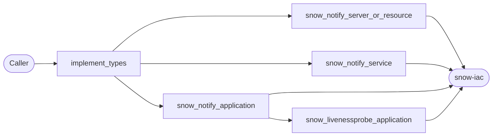
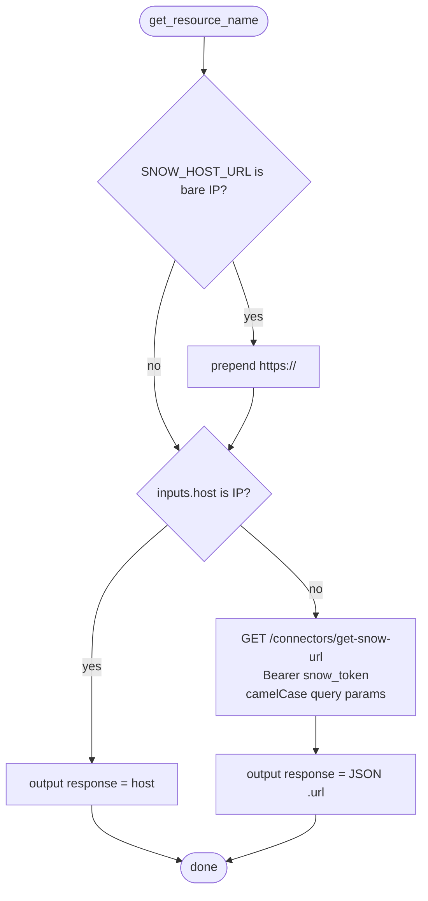
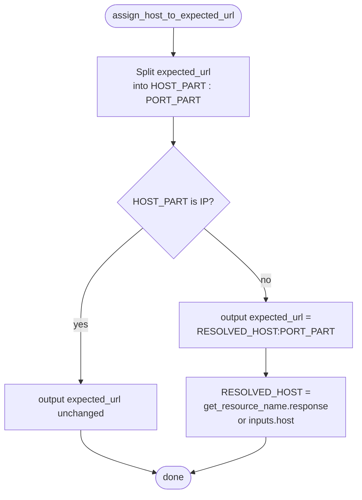
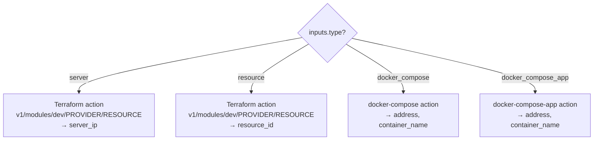

# Workflow logic flow — `main.yml`

Shared contract for every `*-iac` reusable workflow (`hetzner-iac`, future `aws-iac`, `cloudflare-iac`, …). Terraform lives in [snow-monkeys-infra/iac-terraform](https://github.com/snow-monkeys-infra/iac-terraform). For what the checkout actually contains see [TERRAFORM_COMPLIANCE.md](TERRAFORM_COMPLIANCE.md). For internals see [INTERNAL.md](INTERNAL.md). For the caller contract see [INPUTS_OUTPUTS.md](INPUTS_OUTPUTS.md). For examples see [EXAMPLES.md](EXAMPLES.md).

---

## Terraform source of truth

`type: server` and `type: resource` clone `iac-terraform` and apply one module:

```
v1/modules/<env>/<provider>/<resource>/
```

| Token | Source |
|---|---|
| `<env>` | `dev` today (`staging` / `prod` when those folders exist) |
| `<provider>` | `inputs.provider` — `hetzner`, `aws`, `cloudflare`, `civo`, `gcp`, `digitalocean`, … |
| `<resource>` | `inputs.resource`, or the folder mapped for that provider + type in `list-of-resources.md` |

Compose types never touch Terraform.

| `inputs.type` | Meaning | Module |
|---|---|---|
| `server` | Compute / host | Folder marked `type -> server` (e.g. `hetzner/hcloud_server`, `digitalocean/droplet`) |
| `resource` | Non-host cloud object | Folder marked `type -> resource` (e.g. `hetzner/hcloud_firewall`, `cloudflare/dns`, `aws/aws_s3_bucket`) |
| `docker_compose` | SSH deploy a service | — |
| `docker_compose_app` | SSH deploy an app + Docker cleanup | — |

There are **four type values** and **three actions**. `server` and `resource` share the Terraform action; the module directory is selected by `provider` + `resource`.

Modules are independent. A server module does not create attached resources (firewall, DNS, bucket) unless that module says so. Attach later with module inputs (`apply_to`, record target, …).

---

## Overview

```
Caller repo
    │
    ▼ workflow_call (inputs + secrets)
┌─────────────────────────────────────────────────────────┐
│  main.yml   (snow-monkeys-modules/<provider>-iac)       │
│                                                         │
│  Job 1: implement_types                                 │
│    checkout → host resolution → one deployment action   │
│                                                         │
│  Job 2: snow_notify_*  (one of three, by type)          │
│                                                         │
│  Job 3: snow_livenessprobe_application  (optional)      │
└─────────────────────────────────────────────────────────┘
    │
    ▼ workflow outputs
Caller repo
```

The workflow always runs **Job 1**. **Job 2** runs based on `inputs.type`. **Job 3** runs only for `docker_compose_app` when `health_url` is not empty.

`hetzner-iac` currently names Job 1 `implement_hetzner_types`. New provider workflows should use `implement_types`.

---

## Job dependency graph



| Job | Runs when | Needs |
|---|---|---|
| `implement_types` | Always | — |
| `snow_notify_server_or_resource` | `type == server` or `resource` | `implement_types` |
| `snow_notify_service` | `type == docker_compose` | `implement_types` |
| `snow_notify_application` | `type == docker_compose_app` | `implement_types` |
| `snow_livenessprobe_application` | `docker_compose_app` and `health_url != ''` | `snow_notify_application` |

---

## Job 1: `implement_types`

Single job for all deployment types. **Exactly one** deployment action step runs per workflow call, selected by `inputs.type`.

### Step pipeline

```
checkout
  │
  ├─► get_resource_name              [conditional]
  │
  ├─► assign_host_to_expected_url    [conditional]
  │
  └─► deployment action              [one of three actions]
        ├─ Terraform                 (type: server | resource)
        ├─ docker_compose            (type: docker_compose)
        └─ docker_compose_app        (type: docker_compose_app)
```

### Step 1 — `checkout`

Checks out the **caller** repository (the repo that invoked this workflow).

---

### Step 2 — `get_resource_name`

**Condition:**

```yaml
(inputs.type == 'docker_compose' || inputs.type == 'docker_compose_app') && inputs.host != ''
```

**Logic:**



| Input | Source |
|---|---|
| `HOST` | `inputs.host` |
| `SNOW_HOST_URL` | `inputs.snow_host_url` |
| `ACTOR_ID` | `github.actor_id` |
| `GIT_TYPE` | `inputs.git_type` |
| `SNOW_TOKEN` | `secrets.snow_token` |

| Case | Behaviour | Output `response` |
|---|---|---|
| Step skipped | `host` empty or type is not docker compose | *(empty)* |
| Host is IP | No API call | The IP |
| Host is name | Snow API lookup | Resolved host/IP from `.url` |

**API:**

```
GET {snow_host_url}/connectors/get-snow-url?snowName={host}&actorId={actor_id}&gitType={git_type}
Authorization: Bearer {snow_token}
```

---

### Step 3 — `assign_host_to_expected_url`

**Condition:**

```yaml
inputs.expected_url != ''
```

**Logic:**



| Input | Source |
|---|---|
| `EXPECTED_URL` | `inputs.expected_url` |
| `HOST` | `inputs.host` |
| `RESOLVED_HOST` | `steps.get_resource_name.outputs.response` |

---

### Step 4 — Deployment action (type + provider dispatch)



| `inputs.type` | Action | Module path | Key inputs |
|---|---|---|---|
| `server` | Terraform action | `v1/modules/dev/<provider>/<resource>` | Provider credentials, size/image/location (or provider equivalents), SSH keys when the host is bootstrapped |
| `resource` | Terraform action | `v1/modules/dev/<provider>/<resource>` | Provider credentials, `name`, module-specific vars |
| `docker_compose` | `docker-compose` | — | `host`, `expected_url`, SSH keys, secrets |
| `docker_compose_app` | `docker-compose-app` | — | Same as `docker_compose` + Docker cleanup |

**Examples** (`list-of-resources.md` + existing folders):

| Provider | Type | Resource folder | Typical output |
|---|---|---|---|
| `hetzner` | `server` | `hcloud_server` | `server_ipv4` → `server_ip` |
| `hetzner` | `resource` | `hcloud_firewall` | `firewall_id` → `resource_id` |
| `cloudflare` | `resource` | `dns` | record / zone id → `resource_id` |
| `aws` | `resource` | `aws_s3_bucket` | bucket id → `resource_id` |
| `digitalocean` | `server` | `droplet` | `droplet_ip` → `server_ip` |
| `gcp` | `server` | `compute` | instance address → `server_ip` |
| `civo` | `resource` | `bucket` | store id → `resource_id` |

**Terraform create (server and resource):**

```
clone snow-monkeys-infra/iac-terraform
  → cd v1/modules/dev/<provider>/<resource>
  → TF_VAR_* from workflow inputs and provider secrets
  → terraform init → plan → apply
  → read module outputs
```

**Server-only after apply (when the module created a reachable host):** SSH into `server_ip`, copy caller `infra/` to `/tmp/initial-setup/`, run `init.sh`. Resource apply (firewall, DNS, bucket, …) does not SSH.

**Host and URL passed to docker compose actions:**

```yaml
host: ${{ steps.get_resource_name.outputs.response || inputs.host }}
expected_url: ${{ steps.assign_host_to_expected_url.outputs.expected_url || inputs.expected_url }}
```

---

### Job 1 outputs

| Job output | Source | Populated when |
|---|---|---|
| `server_ip` | Terraform public address (`server_ipv4`, `droplet_ip`, …) | `type: server` |
| `resource_id` | Terraform id (`firewall_id`, bucket id, record id, …) | `type: resource` |
| `address` | `steps.docker_compose` **\|\|** `steps.docker_compose_app` | compose types |
| `container_name` | `steps.docker_compose` **\|\|** `steps.docker_compose_app` | compose types |

The `||` merge is safe: only one docker compose step runs per call.

---

## Jobs 2–3: Snow integration (`snow-iac`)

All notify and health jobs call:

```
snow-monkeys-modules/snow-iac/.github/workflows/main.yml@main
```

**Rules:**
- `actor_id` and `actor_name` come from `github.actor_id` and `github.actor` — not caller inputs.
- `snow_token` is forwarded via job `secrets:`, not `with:`.
- `provider` is forwarded so Snow labels the resource with the cloud vendor.

### Notify flow by type

```mermaid
flowchart TD
    subgraph server_path [type: server]
        S1[implement_types] --> S2[snow_notify_server_or_resource]
        S2 --> S3[workflow_type: notify\ntype: CLUSTER\nurl: server_ip]
    end

    subgraph resource_path [type: resource]
        R1[implement_types] --> R2[snow_notify_server_or_resource]
        R2 --> R3[workflow_type: notify\ntype: CLUSTER\nurl: resource_id]
    end

    subgraph service_path [type: docker_compose]
        D1[implement_types] --> D2[snow_notify_service]
        D2 --> D3[workflow_type: notify\ntype: SERVICE\nurl: address or expected_url\nimage: container_name]
    end

    subgraph app_path [type: docker_compose_app]
        A1[implement_types] --> A2[snow_notify_application]
        A2 --> A3[workflow_type: notify\ntype: APPLICATION\nurl: address or expected_url\nimage: container_name]
        A3 --> A4{health_url empty?}
        A4 -->|no| A5[snow_livenessprobe_application]
        A5 --> A6[workflow_type: health]
        A4 -->|yes| skip[skip liveness]
    end
```



### URL fallback (service and application notify)

```yaml
url: ${{ needs.implement_types.outputs.address != '' && needs.implement_types.outputs.address || inputs.expected_url }}
```

---

## End-to-end paths

### Path A — `type: server`

```
checkout
  → clone iac-terraform
  → terraform apply v1/modules/dev/<provider>/<resource>
  → SSH bootstrap infra/init.sh (if the module created a host)
  → snow_notify_server_or_resource (CLUSTER, url = server_ip)
  → output: server_ip
```

### Path A2 — `type: resource`

```
checkout
  → clone iac-terraform
  → terraform apply v1/modules/dev/<provider>/<resource>
  → snow_notify_server_or_resource (CLUSTER, url = resource_id)
  → output: resource_id
```

### Path B — `type: docker_compose`

```
checkout
  → get_resource_name (if host set)
  → assign_host_to_expected_url (if expected_url set)
  → docker-compose action (SSH deploy, init.sh)
  → snow_notify_service (SERVICE, url + container_name)
  → outputs: address, container_name
```

### Path C — `type: docker_compose_app`

```
checkout
  → get_resource_name (if host set)
  → assign_host_to_expected_url (if expected_url set)
  → docker-compose-app action (cleanup + SSH deploy)
  → snow_notify_application (APPLICATION, url + container_name)
  → snow_livenessprobe_application (if health_url set)
  → outputs: address, container_name
```

---

## Workflow outputs (caller-facing)

| Output | Set on path | Value |
|---|---|---|
| `server_ip` | A | Public address of the provisioned host |
| `resource_id` | A2 | Cloud id of the provisioned resource |
| `address` | B, C | SSH host used for deployment |
| `container_name` | B, C | stdout from remote `init.sh` |

Unset outputs are empty strings. Extra Terraform outputs (`server_id`, `server_status`, `firewall_rules`, …) stay inside the module unless a provider workflow maps them.

---

## Quick reference: what drives each decision

| Decision | Driver |
|---|---|
| Which cloud | `inputs.provider` |
| Which module folder | `inputs.resource` or `list-of-resources.md` for that provider + type |
| Which Terraform module | `v1/modules/dev/<provider>/<resource>/` |
| Run host resolution | `type` is compose + `host` not empty |
| Run expected_url normalization | `expected_url` not empty |
| Which deployment action | `inputs.type` |
| Which notify job | `inputs.type` |
| Run liveness probe | `type == docker_compose_app` + `health_url != ''` |
| Snow resource kind | `CLUSTER` / `SERVICE` / `APPLICATION` |

---

## Related docs

- [TERRAFORM_COMPLIANCE.md](TERRAFORM_COMPLIANCE.md) — checkout vs this spec
- [INTERNAL.md](INTERNAL.md) — actions, module layout, adding a provider
- [INPUTS_OUTPUTS.md](INPUTS_OUTPUTS.md) — workflow and Terraform inputs/outputs
- [NAMING.md](NAMING.md) — snake_case / camelCase conventions
- [EXAMPLES.md](EXAMPLES.md) — caller workflow and local Terraform examples
