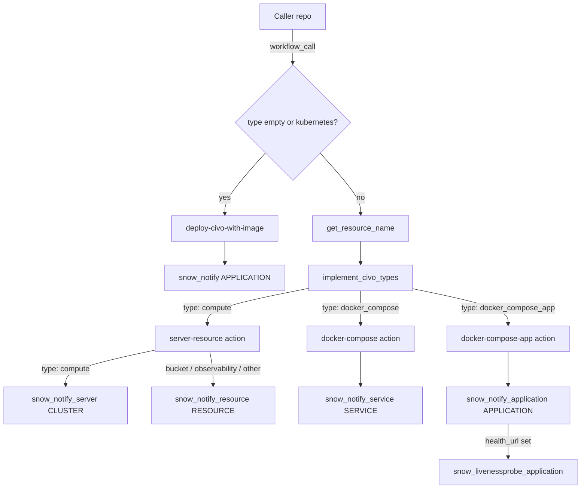

Author: Yabin Monroy Mendez
Description: Civo Module schema

# Civo Snow Provider

Reusable workflow that deploys a container image into Civo Kubernetes, provisions Terraform (`compute` / `bucket` / `observability`), or deploys Docker Compose, then reports the result to Snow (`CLUSTER` / `RESOURCE` / `SERVICE` / `APPLICATION`).

Caller repositories consume it with `workflow_call`. Empty `type` or `type: kubernetes` keeps the Kubernetes image deploy. Terraform and compose paths match the other providers.

| | |
|---|---|
| **Name** | `Civo Snow Provider` |
| **Trigger** | `workflow_call` |
| **Runner** | `ubuntu-22.04` |

---

## Overview



| `type` | What runs | Snow resource |
|---|---|---|
| empty or `kubernetes` | Image deploy via `deployment-image` | `APPLICATION` |
| `compute` | Terraform instance (`iac-terraform/.../civo/compute`), then SSH `init.sh` | `CLUSTER` |
| `bucket` / `observability` / `resource` / other non-compose | Terraform provision | `RESOURCE` |
| `docker_compose` | Copy `$INFRA` + run `init.sh` on a host | `SERVICE` |
| `docker_compose_app` | Same as service, plus Docker cleanup / log rotation | `APPLICATION` |

An empty `type` keeps the Kubernetes flow. Terraform and compose calls use snake_case secrets (`civo_token`, `snow_token`, `ssh_private_key`). The Kubernetes call keeps kebab-case secrets (`civo-token`, `snow-token`). Size, image, and location for Terraform go in `type_values`.

---

## Usage — Kubernetes

```yaml
jobs:
  deploy:
    uses: snow-monkeys-modules/civo-iac/.github/workflows/main.yml@main
    with:
      provider: civo
      name: my-app
      url: localhost
      url-path: /
      port: 80
      image: ghcr.io/example/my-app
      image-tag: latest
      replicas: 1
      min-replicas: 1
      max-replicas: 1
    secrets:
      civo-token: ${{ secrets.CIVO_TOKEN }}
      snow-github-token: ${{ secrets.SNOW_GITHUB_TOKEN }}
      snow-token: ${{ secrets.SNOW_TOKEN }}
      snow-token-pipeline: ${{ secrets.SNOW_TOKEN_PIPELINE }}
```

`snow-token` and `snow-token-pipeline` must be forwarded under `secrets:` (not `with:`). Kubernetes input names are kebab-case.

---

## Usage — Terraform compute


```yaml
jobs:
  deploy:
    uses: snow-monkeys-modules/civo-iac/.github/workflows/main.yml@main
    with:
      snow_host_url: 'https://api.snow-monkeys.com'
      provider: civo
      type: compute             # compute | bucket | observability | docker_compose | docker_compose_app
      resource: ''                    # Terraform module folder; empty → same value as type
      infra: infra
      name: snow-server
      enable_generate_ssh_key: false
      test_flag: false
      s3_bucket_state: ''
      type_values: |
        size=g4s.kube.small
        region=LON1
      state_values: |
        region=us-east-1
        encrypt=true
    secrets:
      civo_token: ${{ secrets.CIVO_TOKEN }}
      aws_access_key_id: ${{ secrets.AWS_ACCESS_KEY_ID }}
      aws_secret_access_key: ${{ secrets.AWS_SECRET_ACCESS_KEY }}
      ssh_public_key: ${{ secrets.SSH_PUBLIC_KEY }}
      ssh_private_key: ${{ secrets.SSH_PRIVATE_KEY }}
      snow_token: ${{ secrets.SNOW_TOKEN }}
      snow_token_pipeline: ${{ secrets.SNOW_TOKEN_PIPELINE }}
      snow_github_token: ${{ secrets.SNOW_GITHUB_TOKEN }}
      env_values: ${{ secrets.ENV_VALUES }}
```

`snow_token` and `snow_token_pipeline` must be forwarded under `secrets:` (not `with:`) when this workflow calls Snow IAC.

---

## Inputs

All inputs are optional at the `workflow_call` contract. Required-in-practice depends on `type`.

### Snow platform

| Name | Type | Default | Description |
|---|---|---|---|
| `snow_host_url` | `string` | `https://api.snow-monkeys.com` | Snow API base URL. A bare IP is prefixed with `https://` before the API call. |
| `provider` | `string` | `civo` | Cloud provider identifier reported to Snow. |
| `type` | `string` | `''` | Empty/`kubernetes` = k8s. Terraform: `compute` \| `bucket` \| `observability`. Compose: `docker_compose` \| `docker_compose_app`. |
| `resource` | `string` | `''` | Terraform module folder: `firewall` \| `certificate` \| `storage_box` \| `volume` \| … If empty, `assign_resource` sets it to `type` so they match. |
| `infra` | `string` | `infra` | Caller-repo directory copied to the remote host. |
| `name` | `string` | `snow-server` | Resource name registered in Snow and used on the host. |
| `host` | `string` | `snow-server` | SSH target for compose deployments: IP, hostname, or Snow service name (resolved via API when not an IP). |
| `git_type` | `string` | `github` | VCS used for Snow actor lookup: `github` \| `gitlab`. |
| `enable_generate_ssh_key` | `boolean` | `false` | Forwarded to `server-resource`. |
| `destroy` | `boolean` | `false` | When `true`, Terraform destroys the resource instead of applying. |
| `environment` | `string` | `''` | Target environment (`dev`, `qa`, `uat`, `prod`). |
| `expected_url` | `string` | `''` | `hostname:port` reported to Snow. Hostname is replaced with the resolved host when it is not an IP. |
| `health_url` | `string` | `''` | When set with `type: docker_compose_app`, queues a liveness probe after APPLICATION notify. |
| `test_flag` | `boolean` | `false` | Forwarded to all three composite actions. On `server-resource`, `true` runs Terraform destroy after provision. |
| `s3_bucket_state` | `string` | `''` | S3 bucket for Terraform remote state. Empty → remove `backend.tf` and `terraform init`. |
| `state_values` | `string` | `''` | `KEY=VALUE` lines written to `.env` and exported as `TF_VAR_*`. When `s3_bucket_state` is set, `region` is the S3 backend region and `encrypt` (`true` or `false`) is passed as `TF_STATE_ENCRYPT`. |

### Kubernetes (empty `type` or `type: kubernetes`)

`name` is required on this workflow. Kubernetes input names are kebab-case.

| Name | Type | Required | Default | Description |
|---|---|---|---|---|
| `url` | `string` | no | `localhost` | Application URL. Passed to the deploy action and to Snow as `url`. |
| `url-path` | `string` | no | `/` | URL path. Passed to the deploy action and to Snow as `url_path`. |
| `port` | `number` | no | `80` | Application port. |
| `image` | `string` | no | `''` | Container image name. Unused by Terraform types. |
| `image-tag` | `string` | no | `latest` | Container image tag. |
| `replicas` | `number` | no | `1` | Replica count. |
| `min-replicas` | `number` | no | `1` | Minimum replicas. |
| `max-replicas` | `number` | no | `1` | Maximum replicas. |

### Civo (used when `type` is `compute`, `resource`, or any non-compose type)

| Name | Type | Default | Description |
|---|---|---|---|
| `type_values` | `string` | `''` | `KEY=VALUE` lines written with `env_values` as `.env` inside the Terraform module directory. Pass `size`, `region`, and other module vars here. Dedicated `server_type` / `image` / `location` workflow inputs were removed. |

Example `type_values`:

```yaml
type_values: |
  size=g4s.kube.small
  region=LON1
```

---

## Secrets

All secrets are `required: false` on the workflow contract. Pass only those the selected `type` needs.

| Name | Required when | Description |
|---|---|---|
| `civo_token` | terraform types | Civo API token (snake_case Terraform / compose path). |
| `civo-token` | Kubernetes | Civo API token (kebab-case Kubernetes path). |
| `snow-token` / `snow-token-pipeline` / `snow-github-token` | Kubernetes | Snow and GitHub tokens for the Kubernetes path. |
| `aws_access_key_id` | when `s3_bucket_state` is set | AWS access key for the S3 Terraform backend (`AWS_ACCESS_KEY_ID`). |
| `aws_secret_access_key` | when `s3_bucket_state` is set | AWS secret key for the S3 Terraform backend (`AWS_SECRET_ACCESS_KEY`). |
| `ssh_public_key` | all types | SSH public key installed on the host / used by Terraform. |
| `ssh_private_key` | all types | SSH private key used by the runner to reach the remote host. |
| `snow_token` | host resolution, notify, health | Snow API token forwarded to Snow IAC. |
| `snow_token_pipeline` | host resolution, notify, health | Snow API Bearer token used by `get_resource_name` and notify. |
| `snow_github_token` | `server-resource` only | GitHub token used on the runner to clone `iac-terraform`. Not passed to the compose actions. |
| `env_values` | `compute`, `resource`, compose / app (optional) | `.env` contents. Written into the Terraform module directory with `type_values`, or on the remote before `init.sh` for compose. |

Example `env_values`:

```yaml
env_values: |
  DB_USER=${{ vars.DB_USER }}
  DB_PASSWORD=${{ secrets.DB_PASSWORD }}
```

---

## Outputs

Workflow-level outputs are taken from job `implement_civo_types`.

| Name | Source | Description |
|---|---|---|
| `server_ip` | `steps.server_ip.outputs.server_ip` | Instance IP from Civo when the module exports it (`type: compute`, `resource`, or other non-compose type). |
| `address` | `docker_compose` **or** `docker_compose_app` | Host address from the compose deployment that ran. |
| `container_name` | `docker_compose` **or** `docker_compose_app` | Container name printed by `init.sh` on the remote host. |
| `docker_output` | `docker_compose` **or** `docker_compose_app` | Docker logs from that container, as one-line JSON `{"container_name":"...","logs":"..."}`. |
| `docker_vars` | `docker_compose` **or** `docker_compose_app` | Compose service fields (`image`, `container_name`, `ports`, and the rest) as one-line JSON. |
| `terraform_output` | `steps.server_ip.outputs.terraform_output` | Terraform outputs as one-line JSON. Set for terraform types. |
| `terraform_vars` | `steps.server_ip.outputs.terraform_vars` | Non-secret `TF_VAR_*` values as one-line JSON. |

`address`, `container_name`, `docker_output`, and `docker_vars` use `||` so whichever compose step ran supplies the value.

---

## Jobs

| Job | Runs when | Needs | Purpose |
|---|---|---|---|
| `deploy-civo-with-image` | `type` empty or `kubernetes` | — | Checkout and deploy the image when `provider` is `civo`. |
| `snow_notify` | that deploy succeeded | `deploy-civo-with-image` | Report Kubernetes `APPLICATION` to Snow. |
| `get_resource_name` | `docker_compose` or `docker_compose_app`, and `host` is not empty | — | Resolve `host` via Snow before deploy. |
| `implement_civo_types` | `type` is set and is not `kubernetes`, and `get_resource_name` did not fail | `get_resource_name` | Checkout, assign resource, run exactly one provision action. |
| `snow_notify_server` | `implement_civo_types` succeeded and `type` is `compute` | `implement_civo_types` | Report `CLUSTER` to Snow. |
| `snow_notify_resource` | `implement_civo_types` succeeded and `type` is `resource`, or any type that is not `compute` / `docker_compose` / `docker_compose_app` | `implement_civo_types` | Report `RESOURCE` to Snow. |
| `snow_notify_service` | `implement_civo_types` succeeded and `type` is `docker_compose` | `implement_civo_types` | Report `SERVICE` to Snow. |
| `snow_notify_application` | `implement_civo_types` succeeded and `type` is `docker_compose_app` | `implement_civo_types` | Report `APPLICATION` to Snow. |
| `snow_livenessprobe_application` | `snow_notify_application` succeeded, `type` is `docker_compose_app`, and `health_url` is set | `snow_notify_application` | Queue a health check in Snow. |

`actor_id` / `actor_name` come from `github.actor_id` and `github.actor`, not from caller inputs.

---

## `get_resource_name`

Resolves `inputs.host` before the implement job runs. Calls `snow-monkeys-modules/snow-iac/.github/workflows/main.yml@main`.

**Condition:** `type` is `docker_compose` or `docker_compose_app`, and `host` is not empty. Otherwise the job is skipped.

| Input | Value |
|---|---|
| `workflow_type` | `get_resources` |
| `snow_host_url` | `inputs.snow_host_url` |
| `resource_name` | `inputs.host` |
| `actor_id` | `github.actor_id` |
| `git_type` | `inputs.git_type` |

`snow_token` and `snow_token_pipeline` are forwarded under `secrets:`.

| Case | Behavior |
|---|---|
| `host` empty | Job skipped. Compose steps fall back to `inputs.host`. |
| `host` is an IP | Used as-is; no API call. |
| `host` is a name | Snow API resolves the name to a host/IP (`GET /connectors/get-snow-url`). |

**Output:** `needs.get_resource_name.outputs.response`

The implement job needs this job. It still runs when `get_resource_name` was skipped. It stops when `get_resource_name` failed or the run was cancelled.

---

## `implement_civo_types`

Runs after `get_resource_name`. Exactly one provision action step runs per call.

### Steps

#### 0. Checkout

`actions/checkout@v4` — checks out the caller repository on the runner.

#### 1. Assign resource if empty (`id: assign_resource`)

If `inputs.resource` is empty, sets `RESOURCE` to `inputs.type` so `resource` and `type` have the same value. Otherwise keeps `inputs.resource`.

**Output:** `steps.assign_resource.outputs.resource` — passed to `server-resource` as `resource`.

#### 2. Assign host to `expected_url` (`id: assign_host_to_expected_url`)

Normalizes `expected_url` so Snow is notified with a reachable host.

**Condition:** `inputs.expected_url` is not empty (skipped otherwise).

| Host part of `expected_url` | Result |
|---|---|
| IP | Left unchanged. |
| Name | Replaced with `needs.get_resource_name.outputs.response`; port is kept. Falls back to `inputs.host` if that output is empty. |

**Output:** `steps.assign_host_to_expected_url.outputs.expected_url`

#### 3. Provision server / resource (`id: server_ip`)

**Action:** `snow-monkeys-modules/civo-iac/.github/actions/server-resource@main`

**Condition:** `type` is `compute` or `resource`, or any type that is not `docker_compose` / `docker_compose_app`.

Provisions via Terraform (`iac-terraform`). Passes `resource` from step 1, plus `infra`, `enable_generate_ssh_key`, `test_flag`, `env_values`, `type_values`, `state_values`, and `s3_bucket_state`. The action writes `.env` inside `iac-terraform/v1/modules/dev/civo/$RESOURCE`. Emits `server_ip` for the notify job.

#### 3.1 Echo server IP

Debug print of `steps.server_ip.outputs.server_ip`.

#### 4. Provision service (`id: docker_compose`)

**Action:** `snow-monkeys-modules/civo-iac/.github/actions/docker-compose@main`

**Condition:** `type` is `docker_compose`.

`host` is `needs.get_resource_name.outputs.response`, or `inputs.host` when that output is empty. `expected_url` is the normalized value from the assign step. Copies `infra/` from the caller repo to the remote and runs `init.sh`. Also receives `test_flag`.

#### 4.1 Echo service address

Debug print of `steps.docker_compose.outputs.address`.

#### 5. Provision application (`id: docker_compose_app`)

**Action:** `snow-monkeys-modules/civo-iac/.github/actions/docker-compose-app@main`

**Condition:** `type` is `docker_compose_app`.

Same flow as service, plus Docker disk cleanup and log rotation on the remote before deploy. Also receives `test_flag`.

#### 5.1 Echo application address

Debug print of `steps.docker_compose_app.outputs.address`.

---

## Composite actions

Called from the implement job. Each action lives in `snow-monkeys-modules/civo-iac`.

### `server-resource` — Server & resources

Terraform provision for a Civo server or related resource.

#### Inputs

| Name | Default | Description |
|---|---|---|
| `provider` | `civo` | Cloud provider. |
| `type` | `compute` | `compute` or `resource`. |
| `resource` | `compute` | Module folder under `iac-terraform` (workflow default is empty; `assign_resource` fills it from `type`). |
| `name` | `snow-server` | Resource name. |
| `destroy` | `false` | Destroy instead of apply. |
| `enable_generate_ssh_key` | `false` | Enable generate SSH key. |
| `civo_token` | `''` | Civo API token. |
| `aws_access_key_id` | `''` | AWS access key for the S3 Terraform backend. |
| `aws_secret_access_key` | `''` | AWS secret key for the S3 Terraform backend. |
| `ssh_public_key` | `''` | SSH public key. |
| `ssh_private_key` | `''` | SSH private key. |
| `snow_github_token` | `''` | Token used on the runner to clone `iac-terraform`. |
| `snow_token` | `''` | Snow API token. |
| `env_values` | `''` | Combined with `type_values` and `state_values` into `.env` in the Terraform module directory. |
| `type_values` | `''` | Combined with `env_values` into `.env` in the Terraform module directory. |
| `state_values` | `''` | Combined into `.env`. When `s3_bucket_state` is set, `region` is the S3 backend region and `encrypt` (`true` or `false`) is `TF_STATE_ENCRYPT`. |
| `s3_bucket_state` | `''` | S3 bucket for Terraform remote state. |
| `git_type` | `github` | Used in `TF_STATE_KEY_PREFIX`. |
| `expected_url` | `''` | URL reported to Snow. |
| `infra` | `infra` | Caller-repo directory copied to `/tmp` on the remote. `mkdir -p /tmp` creates that directory when it does not already exist. |
| `test_flag` | `false` | When `true`, Terraform destroy runs after provision (module path `$RESOURCE`). |

#### Outputs

| Name | Value | Description |
|---|---|---|
| `server_ip` | `${{ steps.create_server.outputs.server_ip }}` | Instance IP from Civo when the module exports it. |
| `terraform_output` | `${{ steps.create_server.outputs.terraform_output }}` | Terraform outputs as one-line JSON. |

#### Steps

1. Checkout.
2. Print `type` and `resource`.
3. Assign `TF_STATE_BUCKET`, `TF_STATE_KEY_PREFIX` (`{name}/{git_type}/{actor_id}/{sha}`), and `TF_STATE_ENCRYPT` (`encrypt` or `TF_VAR_encrypt` from `state_values`).
4. Clone `iac-terraform` (`id: clone_repo`) and `cd` to `iac-terraform/v1/modules/dev/civo/$RESOURCE`. Prints that path, `pwd`, then `ls`.
5. Write `env_values`, `type_values`, and `state_values` as a `.env` file in that module directory; export each key as `TF_VAR_*`.
6. Terraform apply (`id: create_server`): empty `s3_bucket_state` removes `backend.tf` and skips `plan`; otherwise `init -reconfigure` with bucket, key, region, and `encrypt=${TF_STATE_ENCRYPT}` from `state_values`, then `plan`. Init fails when the bucket is set and `region` or `encrypt` is missing → `apply -auto-approve` → `terraform output -json`. The log prints that JSON. `terraform_output` is the same JSON on one line. `server_ip` is `server_ipv4` when that output exists, else `public_ip`, else empty. Missing `server_ipv4` does not fail the apply. Path is `iac-terraform/v1/modules/dev/civo/$RESOURCE`.
7. When `type` is `compute`, `destroy` is false, and apply succeeded, strip `http://` / `https://` from the IP if present.
8. When `type` is `compute`, `destroy` is false, and apply succeeded, configure SSH with `ssh_private_key`.
9. When `type` is `compute`, `destroy` is false, and apply succeeded, copy `$INFRA` to `/tmp` on the remote and write `.env`.
10. When `type` is `compute`, `destroy` is false, and apply succeeded, run `bash init.sh` from `/tmp`. Other types skip steps 7–10.
11. If `test_flag` is true, Terraform destroy twice in `iac-terraform/v1/modules/dev/civo/$RESOURCE` (passes `TF_VAR_*`; remote state uses `region` and `encrypt` from `state_values`).
12. If `destroy` is true, Terraform destroy twice in `iac-terraform/v1/modules/dev/civo/$RESOURCE` (passes `TF_VAR_*`; remote state uses `region` and `encrypt` from `state_values`).

---

### `docker-compose` — Service

Deploys a Docker Compose service onto an existing host.

#### Inputs

| Name | Default | Description |
|---|---|---|
| `provider` | `civo` | Cloud provider. |
| `type` | `service` | Deployment type. |
| `name` | `docker-resource` | Service name. |
| `host` | `snow-server` | SSH target (IP or resolved name). |
| `destroy` | `false` | Destroy / tear down when supported. |
| `ssh_public_key` | `''` | SSH public key. |
| `ssh_private_key` | `''` | SSH private key. |
| `snow_token` | `''` | Snow API token. |
| `env_values` | `''` | Written as `.env` on the remote before `init.sh`. |
| `expected_url` | `''` | URL reported to Snow. |
| `infra` | `infra` | Caller-repo directory copied to `/tmp` on the remote. `mkdir -p /tmp` creates that directory when it does not already exist. |
| `test_flag` | `false` | Test flag (passed through). |

#### Outputs

| Name | Value | Description |
|---|---|---|
| `address` | `${{ steps.make_scripts.outputs.address }}` | Host address after deploy. |
| `container_name` | `${{ steps.make_scripts.outputs.container_name }}` | Name printed by `init.sh`. |
| `docker_output` | `${{ steps.make_scripts.outputs.docker_output }}` | Docker logs as one-line JSON `{"container_name":"...","logs":"..."}`. |
| `docker_vars` | `${{ steps.make_scripts.outputs.docker_vars }}` | Compose service fields as one-line JSON. |

#### Steps

1. Checkout.
2. Print action inputs.
3. Strip `http://` / `https://` from `host` (required for SSH).
4. Write the SSH private key and add the remote host to `known_hosts`. Key file mode must be `600` or SSH rejects it.
5. Copy the caller’s `$INFRA` scripts to `/tmp` on the remote and write `env_values` as `.env`.
6. Run `init.sh` on the remote. Capture stdout as `container_name`. Read `docker logs` for the first line of that stdout and set `docker_output` to `{"container_name":"...","logs":"..."}`. Read the Compose file under `infra/` into `docker_vars`. `address` is the SSH host, or `expected_url` if the host is empty.

---

### `docker-compose-app` — Application

Same deploy as service, with Docker space reclamation and log rotation first.

#### Inputs

Same contract as `docker-compose`, with `type` default `application`.

#### Outputs

Same as `docker-compose`: `address`, `container_name`, `docker_output`, `docker_vars`.

#### Steps

1. Checkout.
2. Strip `http://` / `https://` from `host`.
3. Write the SSH private key (`chmod 600`) and add the host to `known_hosts`.
4. Clean Docker space on the remote (order matters):
   1. Merge log rotation into `/etc/docker/daemon.json` via `jq` (preserve existing keys). Driver `json-file`, 10 MB × 3 files (~30 MB max).
   2. Reload the daemon without killing running containers. Restart only if the distro cannot reload.
   3. Truncate container log files in place (`truncate -s 0`). Truncation keeps the file descriptor valid so running containers are not disrupted.
   4. Prune stopped containers, dangling images, unused networks, and build cache. `-a` and `--volumes` are omitted so tagged images and persistent data stay intact.
5. Copy `$INFRA` to `/tmp` and write `.env`.
6. Run `init.sh`. Capture stdout as `container_name`. Read `docker logs` for the first line of that stdout and set `docker_output` to `{"container_name":"...","logs":"..."}`. Read the Compose file under `infra/` into `docker_vars`. `address` is the SSH host, or `expected_url` if the host is empty.

---

## Snow notify jobs

All notify/health jobs call `snow-monkeys-modules/snow-iac/.github/workflows/main.yml@main`. Each runs only when its needed job succeeded. `snow_token` and `snow_token_pipeline` are forwarded under `secrets:`.

### `snow_notify_server`

Reports a **CLUSTER** after `type: compute`.

| Field | Value |
|---|---|
| `workflow_type` | `notify` |
| `type` | `CLUSTER` |
| `provider` | `inputs.provider` |
| `url` | `needs.implement_civo_types.outputs.server_ip` |
| `terraform_output` | `needs.implement_civo_types.outputs.terraform_output` |

### `snow_notify_resource`

Reports a **RESOURCE** after `type: resource`, or after any `type` that is not `compute`, `docker_compose`, or `docker_compose_app`.

| Field | Value |
|---|---|
| `workflow_type` | `notify` |
| `type` | `RESOURCE` |
| `provider` | `inputs.provider` |
| `url` | `needs.implement_civo_types.outputs.server_ip` |
| `terraform_output` | `needs.implement_civo_types.outputs.terraform_output` |

### `snow_notify_service`

Reports a **SERVICE** after `type: docker_compose`.

| Field | Value |
|---|---|
| `workflow_type` | `notify` |
| `type` | `SERVICE` |
| `provider` | `inputs.provider` |
| `url` | `address` if set, otherwise `inputs.expected_url` |
| `image` | `container_name` |
| `docker_output` | `docker_output` |
| `docker_vars` | `docker_vars` |

### `snow_notify_application`

Reports an **APPLICATION** after `type: docker_compose_app`.

| Field | Value |
|---|---|
| `workflow_type` | `notify` |
| `type` | `APPLICATION` |
| `url` | `address` if set, otherwise `inputs.expected_url` |
| `image` | `container_name` |
| `docker_output` | `docker_output` |
| `docker_vars` | `docker_vars` |

### `snow_livenessprobe_application`

Queues a health check after APPLICATION notify. Skipped when `health_url` is empty.

| Field | Value |
|---|---|
| `workflow_type` | `health` |
| `health_url` | `inputs.health_url` |
| `needs` | `snow_notify_application` |

## `deploy-civo-with-image`

### Steps

#### 1. Echo

Prints `deploy in provider`.

#### 2. Checkout

`actions/checkout@v4` — checks out the caller repository on the runner.

#### 3. Deploy image (`id: deployment_civo`)

**Action:** `snow-monkeys-modules/deployment-image/.github/actions/civo@main`

**Condition:** `provider` is `civo`.

| Input | Value |
|---|---|
| `name` | `inputs.name` |
| `url` | `inputs.url` |
| `url-path` | `inputs.url-path` |
| `port` | `inputs.port` |
| `image` | `inputs.image` |
| `image-tag` | `inputs.image-tag` |
| `replicas` | `inputs.replicas` as a string |
| `min-replicas` | `inputs.min-replicas` as a string |
| `max-replicas` | `inputs.max-replicas` as a string |
| `civo-token` | `secrets.civo-token` |
| `snow-github-token` | `secrets.snow-github-token` |

---

## Composite action — `deploy-image`

Path: `civo-iac/.github/actions/deploy-image/action.yml`.

`main.yml` does not call this action. The workflow calls `deployment-image` instead. The steps below are the action that lives in this repository.

Name: `civo-k8s-tf`. Description: Civo Kubernetes cluster with Terraform.

### Inputs

| Name | Required | Default | Description |
|---|---|---|---|
| `name` | yes | — | Application name. |
| `url` | no | `localhost` | Application URL. |
| `url-path` | no | `/` | URL path. |
| `port` | no | `80` | Application port. |
| `image` | no | `''` | Container image repository. |
| `image-tag` | no | `latest` | Container image tag. |
| `replicas` | no | `1` | Replica count. |
| `min-replicas` | no | `1` | Minimum replicas. |
| `max-replicas` | no | `1` | Maximum replicas. |
| `civo-token` | yes | — | Civo API token. |
| `snow-github-token` | yes | — | GitHub token for mirror repos and Helm templates. |

### Steps

1. Checkout.
2. Look up `snow-monkeys-mirror-repos/mirror-civo-${{ github.event.repository.name }}` with `gh repo view`. The command output is `steps.validate-repo.outputs.EXIST_REPO`.
3. When that output is empty, install the Civo CLI, add `civo-token` as `my-cluster`, save the `k8s_demo_1` kubeconfig, and print `kubectl cluster-info`.
4. When that output is empty, clone `helm-template-public-img-traefik`, create a private repo `snow-monkeys-org/mirror-civo-<caller-repo>`, write `name`, `image`, `image-tag`, `port`, `url`, and `url-path` into the Helm values and application manifest, then push `main`.
5. When that output is set, clone the existing mirror repo, update `image`, `image-tag`, `port`, `url`, and `url-path` in `myapp-helm/values.yaml`, and push `main`.
6. When the mirror repo did not already exist, `kubectl apply` `repo-creds.yaml` and `application.yaml`.

---

## `snow_notify`

Calls `snow-monkeys-modules/snow-iac/.github/workflows/main.yml@main`. Runs only when `deploy-civo-with-image` succeeded. `snow-token` and `snow-token-pipeline` are forwarded under `secrets:`.

Reports an **APPLICATION**.

| Field | Value |
|---|---|
| `workflow_type` | `notify` |
| `provider` | `inputs.provider` |
| `name` | `inputs.name` |
| `type` | `APPLICATION` |
| `url` | `inputs.url` |
| `url_path` | `inputs.url-path` |
| `port` | `inputs.port` |
| `image` | `inputs.image` |
| `image_tag` | `inputs.image-tag` |
| `actor_id` | `github.actor_id` |
| `actor_name` | `github.actor` |
