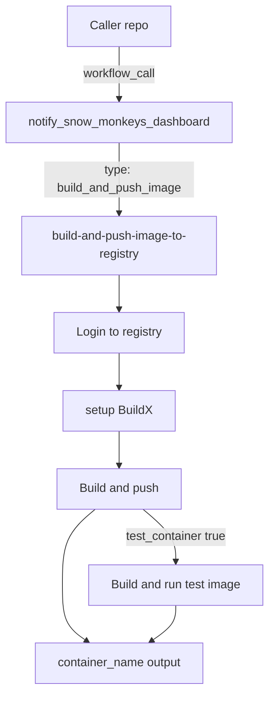

Author: Yabin Monroy Mendez
Description: Docker Module schema

# Docker Snow Provider

Reusable workflow that builds a container image and pushes it to a registry.

Caller repositories consume it with `workflow_call`. The provision path runs when `inputs.type` is `build_and_push_image`.

| | |
|---|---|
| **Name** | `Docker Snow Provider` |
| **Author** | Yabin Monroy |
| **Trigger** | `workflow_call` |
| **Runner** | `ubuntu-22.04` |

---

## Overview



| `type` | What runs | Output |
|---|---|---|
| `build_and_push_image` | Login, Buildx, multi-arch push, optional local test run | `container_name` (`<name>:latest`) |

---

## Usage

```yaml
jobs:
  deploy:
    uses: snow-monkeys-modules/docker-iac/.github/workflows/main.yml@main
    with:
      type: build_and_push_image
      registry: docker.io
      name: my-org/my-image
      tag: latest
      platforms: linux/amd64,linux/arm64,linux/arm64/v8
      docker_file: Dockerfile
      infra: ''                    # empty = repository root
      test_container: false
      test_flag: false
    secrets:
      registry_user: ${{ secrets.REGISTRY_USER }}
      registry_token: ${{ secrets.REGISTRY_TOKEN }}
      snow_token: ${{ secrets.SNOW_TOKEN }}
```

---

## Inputs

All inputs are optional at the `workflow_call` contract.

| Name | Type | Default | Description |
|---|---|---|---|
| `type` | `string` | `build_and_push_image` | Deployment path. The action step runs only when this equals `build_and_push_image`. |
| `registry` | `string` | `docker.io` | Registry host. See [Registries](#registries). |
| `name` | `string` | `''` | Image name without tag. Pushed and reported as `<name>:latest`. |
| `tag` | `string` | `latest` | Image tag input (current build tags `:latest`). |
| `platforms` | `string` | `linux/amd64,linux/arm64,linux/arm64/v8` | Forwarded to the action. The build step currently hardcodes these three platforms. |
| `test_container` | `boolean` | `false` | When `true`, build a local test image and `docker run` it. |
| `enable_cloud_builder` | `boolean` | `false` | Reserved: cloud Buildx driver. Not used in steps yet. |
| `endpoint` | `string` | `''` | Reserved: cloud Buildx endpoint. Not used in steps yet. |
| `docker_file` | `string` | `Dockerfile` | Dockerfile filename inside the build context. |
| `infra` | `string` | `''` | Build context directory. Empty means repository root (`.`). |
| `test_flag` | `boolean` | `false` | Forwarded to the composite action. Not used in steps yet. |

---

## Secrets

All secrets are `required: false` on the workflow contract.

| Name | Description |
|---|---|
| `registry_user` | Registry username. For ECR this is the AWS access key id. |
| `registry_token` | Registry password/token. For ECR this is the AWS secret key. For GCR / Artifact Registry this is a GCP service-account JSON key. |
| `snow_token` | Snow API Bearer token. Forwarded to the action; not used in steps yet. |

---

## Outputs

The reusable workflow does not declare `workflow_call` outputs, so callers do not receive `container_name`.

The job still sets an output:

| Name | Source | Description |
|---|---|---|
| `container_name` | `steps.build_and_push.outputs.container_name` | Image reference: `<name>:latest`. |

---

## Jobs

| Job | Runs when | Needs | Purpose |
|---|---|---|---|
| `notify_snow_monkeys_dashboard` | always | — | Checkout, then run the build-and-push action when `type` is `build_and_push_image`. |

---

## Job 1 — `notify_snow_monkeys_dashboard`

### Steps

#### 0. Checkout

`actions/checkout@v4` — checks out the caller repository on the runner.

#### 1. Build and push (`id: build_and_push`)

**Action:** `snow-monkeys-modules/docker-iac/.github/actions/build-and-push-image-to-registry@main`

**Condition:** `type` is `build_and_push_image`.

Logs into the registry, creates a Buildx builder, pushes a multi-arch image, optionally runs a test container, and sets `container_name`.

---

## Registries

Login is `docker login --password-stdin` (no third-party login actions). `inputs.registry` selects the host.

| `registry` | Login |
|---|---|
| `docker.io` or empty | `registry_user` + `registry_token` against Docker Hub |
| `ghcr.io` | same, against GHCR |
| `*.azurecr.io` | same, against the ACR host |
| `public.ecr.aws` | AWS keys in `registry_user` / `registry_token`; `aws ecr-public get-login-password` (region `us-east-1`) |
| `*.dkr.ecr.<region>.amazonaws.com` | same AWS keys; region taken from the hostname |
| `gcr.io` / `*.gcr.io` | username `_json_key`; `registry_token` is the service-account JSON |
| `*-docker.pkg.dev` | same JSON key against Artifact Registry |
| anything else | `registry_user` + `registry_token` against that host |

---

## Composite action

Called from job 1. Lives in `snow-monkeys-modules/docker-iac`.

### `build-and-push-image-to-registry`

Build and push a container image to the specified registry.

**Author:** Yabin Monroy

#### Inputs

| Name | Default | Description |
|---|---|---|
| `registry` | `docker.io` | Registry host. |
| `name` | `''` | Image name without tag. |
| `tag` | `latest` | Image tag input (output currently uses `:latest`). |
| `platforms` | `linux/amd64,linux/arm64,linux/arm64/v8` | Accepted; build step hardcodes the three platforms. |
| `test_container` | `''` | When `true`, build and run a local test image. |
| `enable_cloud_builder` | `''` | Reserved. Not used yet. |
| `endpoint` | `''` | Reserved. Not used yet. |
| `docker_file` | `Dockerfile` | Dockerfile name inside the build context. |
| `infra` | `''` | Build context directory; empty → `.`. |
| `test_flag` | `false` | Accepted. Not used in steps yet. |
| `registry_user` | — | Username, or AWS access key id for ECR. |
| `registry_token` | — | Password/token, AWS secret key, or GCP service-account JSON. |
| `snow_token` | — | Snow API token. Not used in steps yet. |

The workflow passes `type`. The action does not declare that input.

#### Outputs

| Name | Value | Description |
|---|---|---|
| `container_name` | `${{ steps.set_container_name.outputs.container_name }}` | `<name>:latest`. |

#### Steps

1. Checkout.
2. Login to the registry from `inputs.registry` (see [Registries](#registries)).
3. Create Buildx builder `multi-builder` (`docker buildx create --name multi-builder --use --bootstrap`).
4. Build and push (`id: build`). The step name mentions an empty `name`, but the script always builds. Platforms are hardcoded to `linux/amd64,linux/arm64,linux/arm64/v8`. Context is `inputs.infra`, or `.` if empty. Dockerfile is `$CONTEXT/$DOCKER_FILE`. Tag is `$IMAGE_NAME:latest`. On failure prints `error: docker build and push failed for <image>:latest` and exits 1.
5. If `test_container` is the string `true`: build `test-<name>:latest` with `--load` on `linux/amd64`, then `docker run --rm`. On failure prints `error: test image build failed` or `error: test image run failed` and exits 1. After a successful run, sleeps 5 seconds.
6. Set output `container_name` (`id: set_container_name`) to `<name>:latest`.
