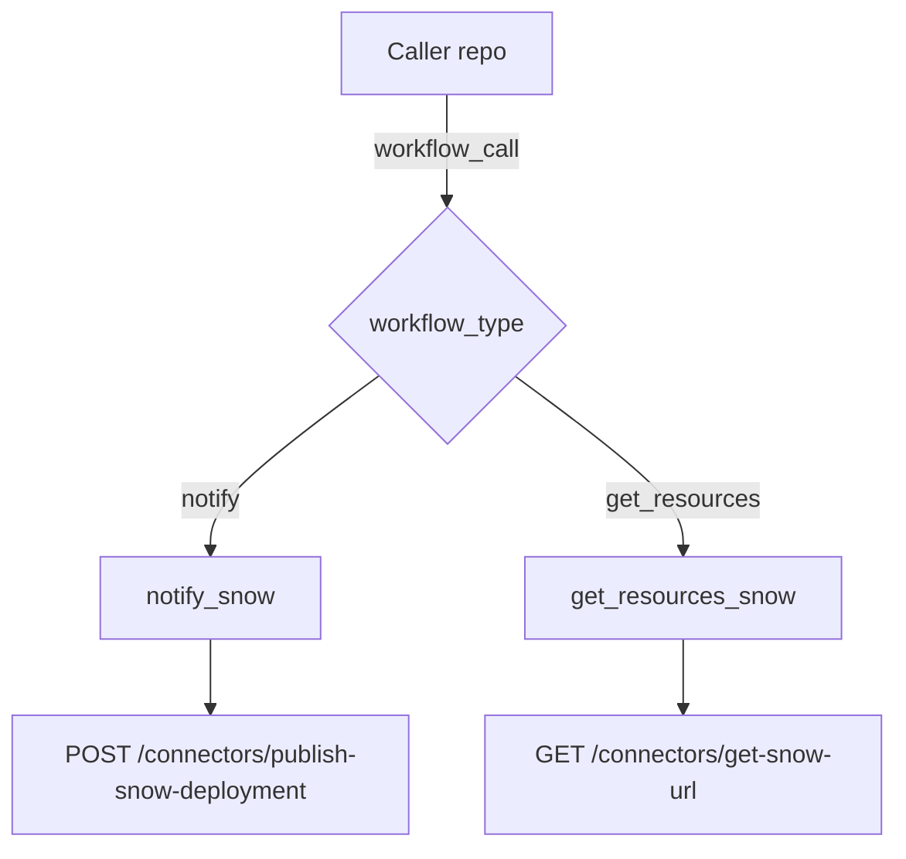

Author: Yabin Monroy Mendez
Description: Snow Module schema

# Notify

Reusable workflow that either publishes a deployment to the Snow API or resolves a Snow resource name to a host.

Caller repositories consume it with `workflow_call`. `workflow_type` selects the job.

| | |
|---|---|
| **Name** | `Notify` |
| **Trigger** | `workflow_call` |
| **Runner** | `ubuntu-22.04` |

---

## Overview



| `workflow_type` | Job | What it does |
|---|---|---|
| `notify` (default) | `notify_snow` | POST a deployment record. Continues if the request fails. |
| `get_resources` | `get_resources_snow` | Resolve `resource_name` to a host. Output `response`. |
| any other value | none | No job runs. |

---

## Usage

Notify:

```yaml
jobs:
  notify:
    uses: snow-monkeys-modules/snow-iac/.github/workflows/main.yml@main
    with:
      workflow_type: notify
      snow_host_url: https://api.snow-monkeys.com
      provider: aws
      name: my-service
      actor_id: ${{ github.actor_id }}
      actor_name: ${{ github.actor }}
      git_type: github
      type: CLUSTER
      url: 203.0.113.10
      terraform_output: '{"server_ipv4":{"value":"203.0.113.10"}}'
    secrets:
      snow_token: ${{ secrets.SNOW_TOKEN }}
      snow_token_pipeline: ${{ secrets.SNOW_TOKEN_PIPELINE }}
```

Resolve a host:

```yaml
jobs:
  resolve:
    uses: snow-monkeys-modules/snow-iac/.github/workflows/main.yml@main
    with:
      workflow_type: get_resources
      snow_host_url: https://api.snow-monkeys.com
      resource_name: my-server
      actor_id: ${{ github.actor_id }}
      git_type: github
    secrets:
      snow_token_pipeline: ${{ secrets.SNOW_TOKEN_PIPELINE }}
```

`snow_token` and `snow_token_pipeline` must be forwarded under `secrets:` (not `with:`).

---

## Inputs

| Name | Type | Required | Default | Used by |
|---|---|---|---|---|
| `workflow_type` | `string` | no | `notify` | `notify` or `get_resources`. |
| `snow_host_url` | `string` | no | `https://api.snow-monkeys.com` | Both. A bare IP is prefixed with `https://` before `get-snow-url`. |
| `provider` | `string` | no | `local` | Notify JSON `provider`. |
| `name` | `string` | no | `''` | Notify JSON `snowName`. |
| `actor_id` | `string` | no | `''` | Notify JSON `actorId`. Query `actorId` on get-resources. |
| `actor_name` | `string` | no | `''` | Notify JSON `actor`. |
| `git_type` | `string` | no | `github` | Notify JSON `gitType`. Query `gitType` on get-resources. |
| `type` | `string` | no | — | Notify JSON `snowType` (`CLUSTER`, `RESOURCE`, `SERVICE`, `APPLICATION`). |
| `extras` | `string` | no | `''` | Notify JSON `extras`. |
| `metadata` | `string` | no | `[ orphan ]` | Passed to the notify action. Not included in the POST body. |
| `url` | `string` | no | `''` | Notify JSON `url`. |
| `terraform_output` | `string` | no | `''` | Parsed and sent as JSON `terraformOutput` when non-empty. |
| `url_path` | `string` | no | `''` | Notify JSON `urlPath`. |
| `port` | `string` | no | `''` | Notify JSON `port`. |
| `image` | `string` | no | `''` | Notify JSON `image`. |
| `image_tag` | `string` | no | `''` | Notify JSON `imageTag`. |
| `status` | `string` | no | `''` | Notify JSON `status`. |
| `payload` | `string` | no | `''` | Notify JSON `payload`. |
| `environment` | `string` | no | `''` | Notify JSON `environment`. |
| `registry` | `string` | no | `''` | Notify JSON `registry`. |
| `notes` | `string` | no | `''` | Notify JSON `notes`. |
| `health_url` | `string` | no | `''` | Notify JSON `healthCheckUrl`. |
| `health_check_time` | `string` | no | `''` | Notify JSON `healthCheckTime`. |
| `liveness_type` | `string` | no | `''` | Notify JSON `livenessType`. |
| `liveness_status` | `string` | no | `''` | Notify JSON `livenessStatus`. |
| `liveness_response` | `string` | no | `''` | Notify JSON `livenessResponse`. |
| `resource_name` | `string` | no | `''` | Host to resolve: IP, hostname, or Snow name. |

---

## Secrets

| Name | Required | Used by | Description |
|---|---|---|---|
| `snow_token` | no | Passed into the notify action | Not sent on the request. Authorization uses `snow_token_pipeline`. |
| `snow_token_pipeline` | yes | Notify `Authorization` header and get-resources | Snow API Bearer token. |

---

## Outputs

| Name | Source | Description |
|---|---|---|
| `response` | `jobs.get_resources_snow.outputs.response` | Resolved host. Set when `workflow_type` is `get_resources`. |

---

## Jobs

| Job | Runs when | Purpose |
|---|---|---|
| `notify_snow` | `workflow_type` is `notify` | POST the deployment record. |
| `get_resources_snow` | `workflow_type` is `get_resources` | Resolve `resource_name` and set `response`. |

The jobs do not depend on each other. Only the job that matches `workflow_type` runs.

---

## `notify_snow`

**Action:** `snow-monkeys-modules/snow-iac/.github/actions/notify@main` (`id: notify`)

### Steps

1. Print `notify snow monkeys`.
2. Build a JSON body with `jq` and `POST` it. The step continues on error.

**Request**

| | |
|---|---|
| Method | `POST` |
| URL | `<snow_host_url>/connectors/publish-snow-deployment` |
| Header | `Authorization: Bearer <snow_token_pipeline>` |
| Header | `Content-Type: application/json` |

The body always includes `tabName` `Main Tab`, `tabId` `1`, and an empty `description`. `email` is `<github.actor>@users.noreply.github.com`. `sha`, `repository`, and `repositoryOwner` come from the GitHub context.

`terraformOutput` is added only when `terraform_output` is non-empty. The value is parsed with `fromjson`, so it must be valid JSON. `dockerOutput` and `dockerVars` are parsed the same way when those inputs are non-empty.

The response body is printed. A failed request does not fail the step.

---

## `get_resources_snow`

**Action:** `snow-monkeys-modules/snow-iac/.github/actions/get-resources@main` (`id: get_resources`)

**Output:** `steps.get_resources.outputs.response`

### Steps

The step prints `HOST`, `SNOW_HOST_URL`, `ACTOR_ID`, and `GIT_TYPE`. The pipeline token is printed as `set` or `empty`.

| Case | Behavior |
|---|---|
| `resource_name` is an IPv4 address | No API call. `response` is that IP. |
| `resource_name` is a name | `GET <snow_host_url>/connectors/get-snow-url?snowName=<name>&actorId=<actor_id>&gitType=<git_type>` with `Authorization: Bearer <snow_token_pipeline>`. |

The log prints the request URL and the raw response. `response` is the JSON field `.url`. The step fails when `.url` is missing, empty, or `null`.

A bare IP `snow_host_url` with no `http://` or `https://` prefix gets `https://` before the call.
