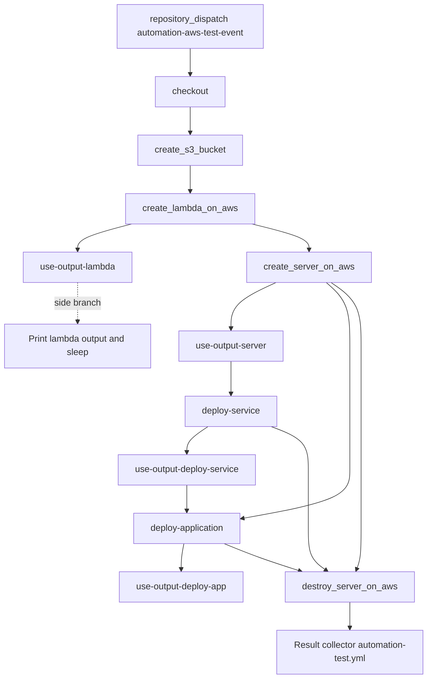

# AWS Test Flow

**Author:** Yabin Monroy Mendez  
**Description:** End-to-end flow for `examples/.github/workflows/test-aws.yml`.  
**Workflow name:** `Automation test AWS modules` (`name` and `run-name`)  
**Rules:** [test-suite-rules.md](test-suite-rules.md)

## Purpose

This workflow is the AWS test bed. The master orchestrator starts it
with `automation-aws-test-event`. It follows the suite rules in this
order:

1. Provision AWS S3 state storage.
2. Create and destroy one catalog resource in one job.
3. Create an EC2 server (`aws_instance`).
4. Deploy a Docker Compose service on that server.
5. Deploy a Docker Compose application on that server.
6. Destroy the server.

Steps 1, 2, 3, and 6 do not continue on fail. Steps 4 and 5 can fail
without skipping the other deploy or server destroy. Those deploy jobs
call a reusable workflow, so they cannot use `continue-on-error`. The
jobs after them use `if: always()` instead. A failed deploy still fails
the workflow.

Every reusable-workflow job calls
`snow-monkeys-modules/aws-iac/.github/workflows/main.yml@main`.

Output jobs print the upstream address and sleep 5 seconds. They sit
on the resource, server, service, and application jobs.

On this provider, catalog type `server` is workflow `type: server` with
`resource` set to the module folder. Catalog type `resource` is workflow
`type: resource` with `resource` set to the module folder. Step 1 passes
`type: aws_s3_bucket`, which the AWS workflow treats as a resource and
uses as the Terraform module folder.

## AWS resources

Catalog from `snow-monkeys-infra/master-infra/list-of-resources.md`.

| Resource | Type | Job in this workflow |
| --- | --- | --- |
| `aws_s3_bucket` | resource | `create_s3_bucket` (step 1, state storage) |
| `aws_instance` | server | `create_server_on_aws`, `destroy_server_on_aws` |
| `aws_lambda_function` | resource | `create_lambda_on_aws` |
| `aws_elastic_beanstalk_application` | resource | — |
| `aws_ebs_volume` | resource | — |
| `aws_db_instance` | resource | — |

This workflow exercises `aws_s3_bucket` as state storage,
`aws_lambda_function` as the step 2 resource, and `aws_instance` as the
server. Elastic Beanstalk, EBS volume, and DB instance are in the
catalog and have no job here.

## Trigger

```yaml
on:
  workflow_dispatch:
  repository_dispatch:
    types: [ automation-aws-test-event ]
```

The master orchestrator in `automation-test-snow` starts it by posting:

```text
event_type: automation-aws-test-event
```

See [testflow.md](testflow.md) for the dispatch path.

## Components

- **Workflow:** `examples/.github/workflows/test-aws.yml`
- **Reusable AWS IAC:** `snow-monkeys-modules/aws-iac`
- **Server init:** `examples/test-aws/server/infra`
- **Service compose:** `examples/test-aws/service/infra`
- **Application compose:** `examples/test-aws/application/infra`
- **Result collector:** `examples/.github/workflows/automation-test.yml`

## Failure policy

| Step | Job | Continue on fail |
| --- | --- | --- |
| 1 | `create_s3_bucket` | No |
| 2 | `create_lambda_on_aws` | No |
| 3 | `create_server_on_aws` | No |
| 4 | `deploy-service` | Yes. Later jobs use `if: always()`. |
| 5 | `deploy-application` | Yes. Destroy uses `if: always()`. |
| 6 | `destroy_server_on_aws` | No |

`destroy_server_on_aws` uses:

```yaml
if: always() && needs.create_server_on_aws.result == 'success'
```

That job runs whenever the server was created, even if a deploy failed.
It does not ignore its own failure.

## End-to-end flow



`use-output-lambda` and `create_server_on_aws` both depend on
`create_lambda_on_aws`, so they can run in parallel. The lambda output
job is a side branch: no later job lists it in `needs`.

`deploy-application` also depends on `create_server_on_aws` and runs
when that job succeeded, including after a failed service deploy.

`destroy_server_on_aws` depends on `create_server_on_aws`,
`deploy-service`, and `deploy-application`. It runs when the server was
created, including when either deploy failed. It does not depend on the
output jobs.

## Job map

| Job | Needs | `if` | `continue-on-error` |
| --- | --- | --- | --- |
| `checkout` | — | — | No |
| `create_s3_bucket` | `checkout` | — | No |
| `create_lambda_on_aws` | `create_s3_bucket` | — | No |
| `use-output-lambda` | `create_lambda_on_aws` | — | No |
| `create_server_on_aws` | `create_lambda_on_aws` | — | No |
| `use-output-server` | `create_server_on_aws` | — | No |
| `deploy-service` | `use-output-server` | — | No. Unsupported on a reusable-workflow job. |
| `use-output-deploy-service` | `deploy-service` | `always() && result != skipped` | Yes |
| `deploy-application` | `create_server_on_aws`, `use-output-deploy-service` | `always() && server == success` | No. Unsupported on a reusable-workflow job. |
| `use-output-deploy-app` | `deploy-application` | `always() && result != skipped` | Yes |
| `destroy_server_on_aws` | `create_server_on_aws`, `deploy-service`, `deploy-application` | `always() && server == success` | No |

## Job sequence

### 1. `checkout`

Runs on `ubuntu-22.04` and checks out the `examples` repository with
`actions/checkout@v4`.

Later jobs call the reusable workflow and do not reuse this checkout
workspace.

### 2. `create_s3_bucket`

Depends on `checkout`. Calls the AWS IAC reusable workflow with
`type: aws_s3_bucket`. Does not continue on fail.

| Input | Value |
| --- | --- |
| Resource name | `s3-test-snow-monkeys-20261` |
| Region | `us-east-2` |
| Versioning | `true` |
| Encryption | `false` |

This bucket is the Terraform remote state backend for the lambda and
server jobs. It is the only resource removed manually. There is no
destroy job for the bucket.

Every reusable-workflow job passes `snow_token_pipeline`.

### 3. `create_lambda_on_aws`

Depends on `create_s3_bucket`. Calls the AWS IAC reusable workflow with
`type: resource` and `resource: aws_lambda_function`. Does not continue
on fail.

| Input | Value |
| --- | --- |
| `type` | `resource` |
| `resource` | `aws_lambda_function` |
| Resource name | `lambda-aws-test` |
| State bucket | `s3-test-snow-monkeys-20261` |
| State region | `us-east-2` |
| State encryption | `false` |
| `test_flag` | `true` |

`test_flag: true` creates the function and destroys it in the same
reusable-workflow run. The function is gone before the server job
starts.

### 4. `use-output-lambda`

Depends on `create_lambda_on_aws`. Prints
`Url is ${{ needs.create_lambda_on_aws.outputs.server_ip }}` and sleeps
5 seconds. Runs on `ubuntu-22.04`.

No later job depends on this job.

### 5. `create_server_on_aws`

Depends on `create_lambda_on_aws`. Calls the AWS IAC reusable workflow
with `type: server` and `resource: aws_instance`. Does not continue on
fail. If this job fails, deploys and destroy are skipped.

| Input | Value |
| --- | --- |
| `type` | `server` |
| `resource` | `aws_instance` |
| Resource name | `server-aws-test` |
| Infra path | `test-aws/server/infra` |
| State bucket | `s3-test-snow-monkeys-20261` |
| State region | `us-east-2` |
| State encryption | `false` |

`type_values` supplies the EC2 module inputs. `ami` is required.
`server_type` defaults to `t3.micro` and `region` defaults to
`us-east-1` in the module. This suite sets `region=us-east-2` so the
instance matches the state bucket.

### 6. `use-output-server`

Depends on `create_server_on_aws`. Prints
`Url is ${{ needs.create_server_on_aws.outputs.server_ip }}` and sleeps
5 seconds. Runs on `ubuntu-22.04`.

`deploy-service` waits on this job.

### 7. `deploy-service`

Depends on `use-output-server`. Calls the AWS IAC reusable workflow
with `type: docker_compose`. It does not use `continue-on-error`. If it
fails, the app deploy and server destroy still run.

| Input | Value |
| --- | --- |
| Resource name | `server-aws-test` |
| Host | `server-aws-test` |
| Infra path | `test-aws/service/infra` |

`name` and `host` are `server-aws-test`, the same name as the server,
because the service is deployed from the same repository. This job
SSHes to that host and does not pass AWS credentials.

### 8. `use-output-deploy-service`

Depends on `deploy-service`. Runs unless that deploy was skipped:

```yaml
if: always() && needs.deploy-service.result != 'skipped'
continue-on-error: true
```

Prints `Url is ${{ needs.deploy-service.outputs.address }}` and sleeps
5 seconds. Runs on `ubuntu-22.04`.

### 9. `deploy-application`

Depends on `create_server_on_aws` and `use-output-deploy-service`.
Runs whenever the server was created:

```yaml
if: always() && needs.create_server_on_aws.result == 'success'
```

It does not use `continue-on-error`. If it fails, server destroy still
runs.

Calls the AWS IAC reusable workflow with `type: docker_compose_app`.

| Input | Value |
| --- | --- |
| Resource name | `server-aws-test` |
| Host | `server-aws-test` |
| Infra path | `test-aws/application/infra` |

`name` and `host` are `server-aws-test`. This job SSHes to that host
and does not pass AWS credentials.

### 10. `use-output-deploy-app`

Depends on `deploy-application`. Runs unless that deploy was skipped:

```yaml
if: always() && needs.deploy-application.result != 'skipped'
continue-on-error: true
```

Prints
`App connection address is ${{ needs.deploy-application.outputs.address }}`
and sleeps 5 seconds. Runs on `ubuntu-22.04`. Destroy does not wait on
this job.

### 11. `destroy_server_on_aws`

Depends on `create_server_on_aws`, `deploy-service`, and
`deploy-application`. Runs whenever the server was created, including
when either deploy failed:

```yaml
if: always() && needs.create_server_on_aws.result == 'success'
```

It does not use `continue-on-error`. A failed destroy fails the
workflow. Calls the AWS IAC reusable workflow with the same server
inputs as the create job, plus `destroy: true`.

Destroying the server also removes the Docker Compose service and
application that were running on it. Those workloads have no separate
destroy jobs.

The S3 state bucket remains.

## Resource lifecycle

| Resource | Create job | Destroy behavior |
| --- | --- | --- |
| S3 bucket `s3-test-snow-monkeys-20261` | `create_s3_bucket` | Left in place. Manual cleanup. |
| Lambda `lambda-aws-test` | `create_lambda_on_aws` | Destroyed in the same job via `test_flag: true`. |
| Server `server-aws-test` | `create_server_on_aws` | Destroyed later by `destroy_server_on_aws`. |
| Compose service | `deploy-service` | Removed when the server is destroyed. Workflow `name` is `server-aws-test`. |
| Compose application | `deploy-application` | Removed when the server is destroyed. Workflow `name` is `server-aws-test`. |

## Secrets

| Secret | Used by |
| --- | --- |
| `AWS_ACCESS_KEY_ID` | S3, lambda, server create/destroy |
| `AWS_SECRET_ACCESS_KEY` | S3, lambda, server create/destroy |
| `SSH_PUBLIC_KEY_TEST` | Lambda, server, service, application |
| `SSH_PRIVATE_KEY_TEST` | Lambda, server, service, application |
| `SNOW_GITHUB_TOKEN` | Every reusable-workflow job |
| `SNOW_TOKEN_PIPELINE` | Every reusable-workflow job |

AWS access keys are the provider credentials. Service and application
jobs do not pass them. They SSH to the already created
`server-aws-test` host.

## Result collection

When this workflow finishes, `automation-test.yml` runs because it
listens for:

```text
Automation test AWS modules
```

It then prints an AWS success or failure notification from
`github.event.workflow_run.conclusion`.

## Failure behavior

- If S3, lambda, or server create fails, jobs that `need` them are skipped. Destroy runs only after the server was created.
- If `deploy-service` fails, `deploy-application` and `destroy_server_on_aws` still run.
- If `deploy-application` fails, `destroy_server_on_aws` still runs.
- If `destroy_server_on_aws` fails, the workflow fails.
- `use-output-lambda` failing does not stop the server chain, because `create_server_on_aws` does not depend on it.
- The S3 bucket stays, on success and on failure.
- A failure here does not fail the master orchestrator. Dispatch is asynchronous. See [testflow.md](testflow.md).
