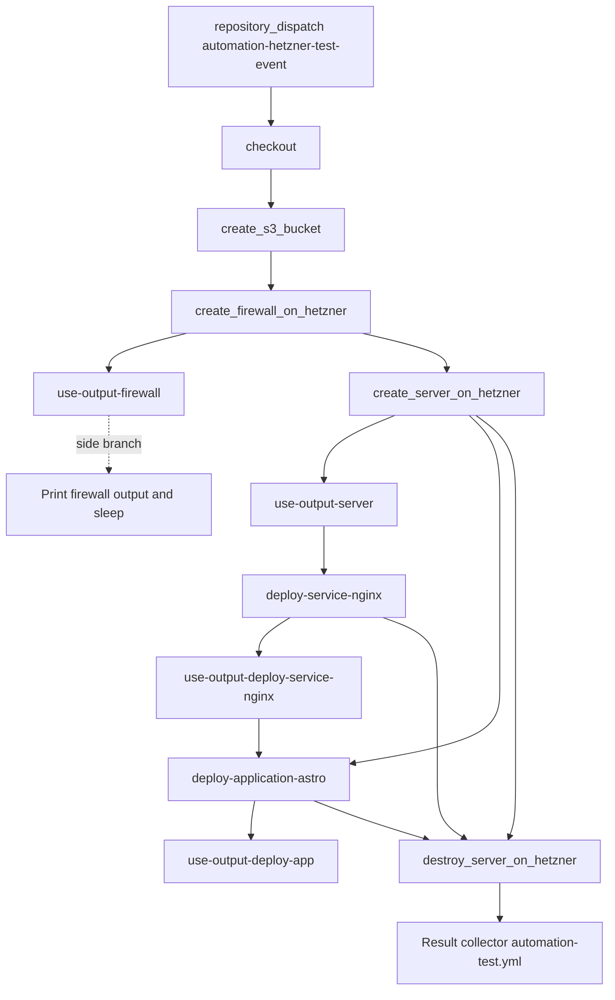

# Hetzner Test Flow

**Author:** Yabin Monroy Mendez  
**Description:** End-to-end flow for `examples/.github/workflows/test-hetzner.yml`.  
**Workflow name:** `Automation test Hetzner modules` (`name` and `run-name`)

## Purpose

This workflow is the Hetzner test bed. The master orchestrator starts it
with `automation-hetzner-test-event`. It validates the Hetzner IAC
reusable workflow in this order:

1. Provision AWS S3 state storage.
2. Create and destroy a Hetzner firewall in one job.
3. Create a Hetzner server.
4. Deploy a Docker Compose service on that server.
5. Deploy a Docker Compose application on that server.
6. Destroy the server.

Steps 1, 2, 3, and 6 do **not** continue on fail. Steps 4 and 5 can
fail without skipping the other deploy or server destroy. Those deploy
jobs call reusable workflows, so they cannot use `continue-on-error`.
The jobs after them use `if: always()` instead. A failed deploy still
fails the workflow.

The reusable workflow lives at
`snow-monkeys-modules/hetzner-iac/.github/workflows/main.yml@main`.
S3 state storage is created by
`snow-monkeys-modules/aws-iac/.github/workflows/main.yml@main`.

## Hetzner resources

Catalog from `snow-monkeys-infra/master-infra/list-of-resources.md`.
Type `server` follows the `hcloud_server` path. Type `resource` follows
the resource path.

| Resource | Type | Job in this workflow |
| --- | --- | --- |
| `hcloud_server` | server | `create_server_on_hetzner`, `destroy_server_on_hetzner` |
| `hcloud_firewall` | resource | `create_firewall_on_hetzner` |
| `hcloud_network` | resource | — |
| `hcloud_volume` | resource | — |
| `hcloud_volume_attachment` | resource | — |
| `hcloud_floating_ip` | resource | — |

This workflow exercises `hcloud_firewall` and `hcloud_server`. Network,
volume, volume attachment, and floating IP are in the catalog and have
no job here.

## Trigger

```yaml
on:
  workflow_dispatch:
  repository_dispatch:
    types: [ automation-hetzner-test-event ]
```

The master orchestrator in `automation-test-snow` starts it by posting:

```text
event_type: automation-hetzner-test-event
```

See [testflow.md](testflow.md) for the dispatch path.

## Components

- **Workflow:** `examples/.github/workflows/test-hetzner.yml`
- **Reusable Hetzner IAC:** `snow-monkeys-modules/hetzner-iac`
- **Reusable AWS IAC:** `snow-monkeys-modules/aws-iac`
- **Server init:** `examples/test-hetzner/server/infra`
- **Service compose:** `examples/test-hetzner/service/infra`
- **Application compose:** `examples/test-hetzner/application/infra`
- **Result collector:** `examples/.github/workflows/automation-test.yml`

## Failure policy

| Step | Job | Continue on fail |
| --- | --- | --- |
| 1 | `create_s3_bucket` | No |
| 2 | `create_firewall_on_hetzner` | No |
| 3 | `create_server_on_hetzner` | No |
| 4 | `deploy-service-nginx` | Yes. Later jobs use `if: always()`. |
| 5 | `deploy-application-astro` | Yes. Destroy uses `if: always()`. |
| 6 | `destroy_server_on_hetzner` | No |

`destroy_server_on_hetzner` also uses:

```yaml
if: always() && needs.create_server_on_hetzner.result == 'success'
```

That job runs whenever the server was created, even if a deploy failed.
It does not ignore its own failure.

## End-to-end flow



`use-output-firewall` and `create_server_on_hetzner` both depend on
`create_firewall_on_hetzner`, so they can run in parallel. The firewall
output job is a dead end: no later job lists it in `needs`.

`deploy-application-astro` also depends on `create_server_on_hetzner`
and runs when that job succeeded, including after a failed service
deploy.

`destroy_server_on_hetzner` depends on `create_server_on_hetzner`,
`deploy-service-nginx`, and `deploy-application-astro`. It runs when
the server was created, including when either deploy failed. It does
not depend on the output jobs.

## Job map

| Job | Needs | `if` | `continue-on-error` |
| --- | --- | --- | --- |
| `checkout` | — | — | No |
| `create_s3_bucket` | `checkout` | — | No |
| `create_firewall_on_hetzner` | `create_s3_bucket` | — | No |
| `use-output-firewall` | `create_firewall_on_hetzner` | — | No |
| `create_server_on_hetzner` | `create_firewall_on_hetzner` | — | No |
| `use-output-server` | `create_server_on_hetzner` | — | No |
| `deploy-service-nginx` | `use-output-server` | — | No. Unsupported on a reusable-workflow job. |
| `use-output-deploy-service-nginx` | `deploy-service-nginx` | `always() && result != skipped` | Yes |
| `deploy-application-astro` | `create_server_on_hetzner`, `use-output-deploy-service-nginx` | `always() && server == success` | No. Unsupported on a reusable-workflow job. |
| `use-output-deploy-app` | `deploy-application-astro` | `always() && result != skipped` | Yes |
| `destroy_server_on_hetzner` | `create_server_on_hetzner`, `deploy-service-nginx`, `deploy-application-astro` | `always() && server == success` | No |

## Job sequence

### 1. `checkout`

Runs on `ubuntu-22.04` and checks out the `examples` repository with
`actions/checkout@v4`.

Later jobs call reusable workflows and do not reuse this checkout
workspace.

### 2. `create_s3_bucket`

Depends on `checkout`. Calls the AWS IAC reusable workflow with
`type: aws_s3_bucket`. Does not continue on fail.

| Input | Value |
| --- | --- |
| Resource name | `s3-test-snow-monkeys-20261` |
| Region | `us-east-2` |
| Versioning | `true` |
| Encryption | `false` |

This bucket is the Terraform remote state backend for the Hetzner
firewall and server jobs. The workflow comment states that this is the
only resource that must be removed manually. There is no destroy job for
the bucket.

### 3. `create_firewall_on_hetzner`

Depends on `create_s3_bucket`. Calls the Hetzner IAC reusable workflow
with `type: hcloud_firewall`. Does not continue on fail.

| Input | Value |
| --- | --- |
| Resource name | `firewall-hetzner-test` |
| State bucket | `s3-test-snow-monkeys-20261` |
| State region | `us-east-2` |
| State encryption | `false` |
| `test_flag` | `true` |

`test_flag: true` creates the firewall and destroys it in the same
reusable-workflow run. The firewall is therefore gone before the server
job starts.

### 4. `use-output-firewall`

Depends on `create_firewall_on_hetzner`. Prints
`Url is ${{ needs.create_firewall_on_hetzner.outputs.server_ip }}` and
sleeps 5 seconds. Runs on `ubuntu-22.04`.

No later job depends on this job.

### 5. `create_server_on_hetzner`

Depends on `create_firewall_on_hetzner`. Calls the Hetzner IAC reusable
workflow with `type: hcloud_server`. Does not continue on fail. If this
job fails, deploys and destroy are skipped.

| Input | Value |
| --- | --- |
| Resource name | `server-hetzner-test` |
| Server type | `cpx12` |
| Image | `ubuntu-26.04` |
| Location | `hel1` |
| Infra path | `test-hetzner/server/infra` |
| State bucket | `s3-test-snow-monkeys-20261` |
| State region | `us-east-2` |
| State encryption | `false` |

Server init runs `test-hetzner/server/infra/init.sh`, which calls
`init/init-hetzner.sh`.

### 6. `use-output-server`

Depends on `create_server_on_hetzner`. Prints
`Url is ${{ needs.create_server_on_hetzner.outputs.server_ip }}` and
sleeps 5 seconds. Runs on `ubuntu-22.04`.

`deploy-service-nginx` waits on this job.

### 7. `deploy-service-nginx`

Depends on `use-output-server`. Calls the Hetzner IAC reusable workflow
with `type: docker_compose`. It does not use `continue-on-error`. If it
fails, the app deploy and server destroy still run.

| Input | Value |
| --- | --- |
| Resource name | `server-hetzner-test` |
| Host | `server-hetzner-test` |
| Infra path | `test-hetzner/service/infra` |
| Expected URL | `server-hetzner-test` |

`name` is `server-hetzner-test`, the same name as the server, because
the service is deployed from the same repository.

`test-hetzner/service/infra/docker-compose.yml` deploys nginx:

- image `nginx:alpine`
- container `my-nginx`
- host port `8080` mapped to container port `80`

Deploy is performed by
`test-hetzner/service/infra/deployment/deploy-in-hetzner.sh`, which runs
`docker compose up -d` on the remote host.

### 8. `use-output-deploy-service-nginx`

Depends on `deploy-service-nginx`. Runs unless that deploy was skipped:

```yaml
if: always() && needs.deploy-service-nginx.result != 'skipped'
continue-on-error: true
```

Prints `Url is ${{ needs.deploy-service-nginx.outputs.address }}` and
sleeps 5 seconds. Runs on `ubuntu-22.04`.

### 9. `deploy-application-astro`

Depends on `create_server_on_hetzner` and
`use-output-deploy-service-nginx`. Runs whenever the server was created:

```yaml
if: always() && needs.create_server_on_hetzner.result == 'success'
```

It does not use `continue-on-error`. If it fails, server destroy still
runs.

Calls the Hetzner IAC reusable workflow with `type: docker_compose_app`.

| Input | Value |
| --- | --- |
| Resource name | `server-hetzner-test` |
| Host | `server-hetzner-test` |
| Infra path | `test-hetzner/application/infra` |
| Expected URL | `server-hetzner-test:4321` |

`name` is `server-hetzner-test`, the same name as the server, because
the application is deployed from the same repository.

This deploys the `growing-gravity` Astro app from
`test-hetzner/application/infra/docker-compose.yml`
(`yabinm/growing-gravity:latest`) on host port `4321`.

### 10. `use-output-deploy-app`

Depends on `deploy-application-astro`. Runs unless that deploy was
skipped:

```yaml
if: always() && needs.deploy-application-astro.result != 'skipped'
continue-on-error: true
```

Prints
`Astro app connection address is ${{ needs.deploy-application-astro.outputs.address }}`
and sleeps 5 seconds. Runs on `ubuntu-22.04`. Destroy does not wait on
this job.

### 11. `destroy_server_on_hetzner`

Depends on `create_server_on_hetzner`, `deploy-service-nginx`, and
`deploy-application-astro`. Runs whenever the server was created,
including when either deploy failed:

```yaml
if: always() && needs.create_server_on_hetzner.result == 'success'
```

It does **not** use `continue-on-error`. A failed destroy fails the
workflow. Calls the Hetzner IAC reusable workflow with the same server
inputs as the create job, plus `destroy: true`.

Destroying the server also removes the Docker Compose service and
application that were running on it. Those workloads have no separate
destroy jobs.

The S3 state bucket remains.

## Resource lifecycle

| Resource | Create job | Destroy behavior |
| --- | --- | --- |
| S3 bucket `s3-test-snow-monkeys-20261` | `create_s3_bucket` | Left in place. Manual cleanup. |
| Firewall `firewall-hetzner-test` | `create_firewall_on_hetzner` | Destroyed in the same job via `test_flag: true`. |
| Server `server-hetzner-test` | `create_server_on_hetzner` | Destroyed later by `destroy_server_on_hetzner`. |
| Nginx service (`nginx:alpine` on port `8080`) | `deploy-service-nginx` | Removed when the server is destroyed. Workflow `name` is `server-hetzner-test`. |
| Astro app (`growing-gravity` on port `4321`) | `deploy-application-astro` | Removed when the server is destroyed. Workflow `name` is `server-hetzner-test`. |

## Secrets

| Secret | Used by |
| --- | --- |
| `AWS_ACCESS_KEY_ID` | S3, firewall, server create/destroy |
| `AWS_SECRET_ACCESS_KEY` | S3, firewall, server create/destroy |
| `HETZNER_CLOUD_TOKEN` | Firewall, server create/destroy |
| `SSH_PUBLIC_KEY_TEST` | Firewall, server, service, application |
| `SSH_PRIVATE_KEY_TEST` | Firewall, server, service, application |
| `SNOW_GITHUB_TOKEN` | Every reusable-workflow job |
| `SNOW_TOKEN_PIPELINE` | Every reusable-workflow job |

Service and application jobs do not pass Hetzner or AWS credentials.
They SSH to the already created `server-hetzner-test` host.

## Result collection

When this workflow finishes, `automation-test.yml` runs because it
listens for:

```text
Automation test Hetzner modules
```

It then prints a Hetzner success or failure notification from
`github.event.workflow_run.conclusion`.

## Failure behavior

- If S3, firewall, or server create fails, jobs that `need` them are
  skipped. Destroy does not run unless the server was created.
- If `deploy-service-nginx` fails, `deploy-application-astro` and
  `destroy_server_on_hetzner` still run.
- If `deploy-application-astro` fails, `destroy_server_on_hetzner`
  still runs.
- If `destroy_server_on_hetzner` fails, the workflow fails.
- `use-output-firewall` failing does not stop the server chain, because
  `create_server_on_hetzner` does not depend on it.
- The S3 bucket is never destroyed by this workflow, success or failure.
- A failure here does not fail the master orchestrator. Dispatch is
  asynchronous. See [testflow.md](testflow.md).
