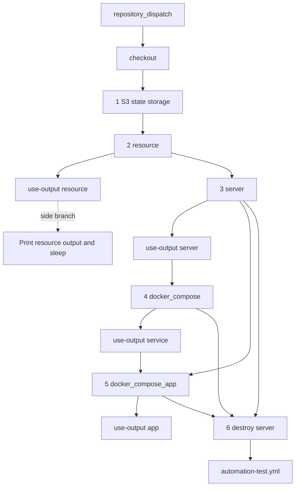

# Test Suite Rules

**Author:** Yabin Monroy Mendez  
**Description:** Required job order and failure policy for a provider test suite.  
**Reference workflow:** `examples/.github/workflows/test-hetzner.yml`  
**Reference suite:** [hetzner-test-suite.md](hetzner-test-suite.md)

Azure, Cloudflare, GCP, DigitalOcean, and AWS suites follow this order.
Hetzner is the worked example. Docker and Snow Monkeys are the
exceptions. See [docker-test-suite.md](docker-test-suite.md) and
[snowmonkeys-test-suite.md](snowmonkeys-test-suite.md).

## Order of execution

After `checkout`, the suite runs in this order:

1. S3 state storage.
2. One catalog resource.
3. One catalog server.
4. `docker_compose` on that server.
5. `docker_compose_app` on that server.
6. Destroy the server.

| Step | Role | `type` | Destroy |
| --- | --- | --- | --- |
| 1 | S3 state storage | `aws_s3_bucket` | Left in place. Manual cleanup. |
| 2 | Resource | A catalog entry whose type is `resource` | Same job, `test_flag: true`. |
| 3 | Server | A catalog entry whose type is `server` | Later, step 6. |
| 4 | Service | `docker_compose` | Removed when the server is destroyed. |
| 5 | Application | `docker_compose_app` | Removed when the server is destroyed. |
| 6 | Destroy server | Same `type` and inputs as step 3, plus `destroy: true` | This job. |

`checkout` runs first on `ubuntu-22.04` with `actions/checkout@v4`.
Later jobs call reusable workflows and do not reuse that workspace.

Step 1 calls `snow-monkeys-modules/aws-iac/.github/workflows/main.yml@main`.
Steps 2 through 6 call that provider's reusable workflow, for example
`snow-monkeys-modules/hetzner-iac/.github/workflows/main.yml@main`.

The resource catalog for each provider lives in
`snow-monkeys-infra/master-infra/list-of-resources.md`. Step 2 uses one
entry marked `resource`. Step 3 uses one entry marked `server`.

## Dependency graph



| Job | Needs | `if` |
| --- | --- | --- |
| `checkout` | — | — |
| S3 | `checkout` | — |
| Resource | S3 | — |
| Resource output | Resource | — |
| Server | Resource | — |
| Server output | Server | — |
| `docker_compose` | Server output | — |
| Service output | `docker_compose` | `always() && result != skipped` |
| `docker_compose_app` | Server, service output | `always() && server == success` |
| App output | `docker_compose_app` | `always() && result != skipped` |
| Destroy server | Server, `docker_compose`, `docker_compose_app` | `always() && server == success` |

The resource output job and the server job both depend on the resource
job, so they can run in parallel. The resource output job is a side
branch: no later job lists it in `needs`.

`docker_compose_app` also depends on the server job. It runs when that
job succeeded, including after a failed service deploy.

Destroy depends on the server job, `docker_compose`, and
`docker_compose_app`. It does not depend on the output jobs. It runs
when the server was created, including when either deploy failed.

## Failure policy

| Step | Continue on fail |
| --- | --- |
| 1 S3 | No |
| 2 Resource | No |
| 3 Server | No |
| 4 `docker_compose` | Yes. Later jobs use `if: always()`. |
| 5 `docker_compose_app` | Yes. Destroy uses `if: always()`. |
| 6 Destroy server | No |

Steps 4 and 5 call reusable workflows, so they cannot use
`continue-on-error`. The jobs after them use `if: always()` instead. A
failed deploy still fails the workflow.

Destroy uses:

```yaml
if: always() && needs.<create_server_job>.result == 'success'
```

Destroy does not use `continue-on-error`. A failed destroy fails the
workflow.

Service and application output jobs use:

```yaml
if: always() && needs.<deploy_job>.result != 'skipped'
continue-on-error: true
```

Each output job prints the upstream address and sleeps 5 seconds on
`ubuntu-22.04`.

- If S3, the resource, or server create fails, jobs that `need` them are skipped. Destroy runs only after the server was created.
- If `docker_compose` fails, `docker_compose_app` and destroy still run.
- If `docker_compose_app` fails, destroy still runs.
- If destroy fails, the workflow fails.
- A failed resource output job does not stop the server chain, because the server job does not depend on it.
- The S3 bucket stays, on success and on failure.
- A failure in the provider workflow does not fail the master orchestrator. Dispatch is asynchronous. See [testflow.md](testflow.md).

## Inputs

Step 1 writes the bucket the later Terraform jobs use as remote state.
Resource and server jobs pass that bucket through `s3_bucket_state` and
`state_values` (`bucket_name`, `region`, `encrypt`).

`test_flag: true` on the resource job creates the resource and destroys
it in the same reusable-workflow run. The resource is gone before the
server job starts.

Destroy repeats the server create inputs and sets `destroy: true`.

`docker_compose` and `docker_compose_app` set `name` and `host` to the
server name, because the service and the application deploy from the
same repository. They SSH to the server already created in step 3.
Those two jobs do not pass provider or AWS credentials.

## Secrets

| Secret | Used by |
| --- | --- |
| `AWS_ACCESS_KEY_ID` | S3, resource, server create, server destroy |
| `AWS_SECRET_ACCESS_KEY` | S3, resource, server create, server destroy |
| Provider token | Resource, server create, server destroy |
| `SSH_PUBLIC_KEY_TEST` | Resource, server, service, application |
| `SSH_PRIVATE_KEY_TEST` | Resource, server, service, application |
| `SNOW_GITHUB_TOKEN` | Every reusable-workflow job |
| `SNOW_TOKEN_PIPELINE` | Every reusable-workflow job |

## Trigger and results

Each suite accepts `workflow_dispatch` and `repository_dispatch` with
`automation-<provider>-test-event`. The master orchestrator in
`automation-test-snow` posts that event. See [testflow.md](testflow.md).

When the workflow finishes, `examples/.github/workflows/automation-test.yml`
runs because it listens for the workflow `name`, then prints success or
failure from `github.event.workflow_run.conclusion`.
