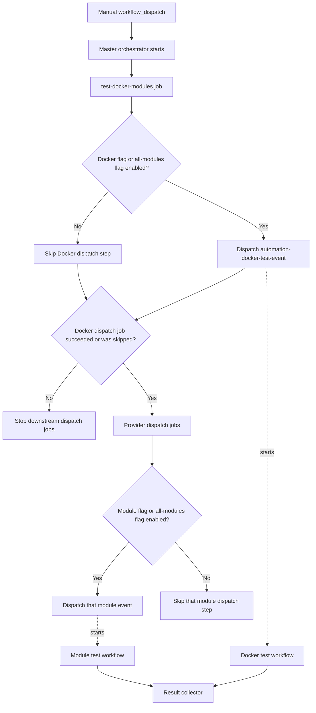

# Automation Test Flow

**Author:** Yabin Monroy Mendez  
**Description:** Test suite orchestration for Snow Monkeys modules.

## Purpose

The `automation-test-snow` repository contains the master GitHub Actions
workflow. A user starts it manually, and it sends `repository_dispatch`
events to workflows in the `test-snow-monkeys/examples` repository.

The test workflows validate Docker, Hetzner, Cloudflare, AWS, Azure, GCP,
and DigitalOcean modules. A separate workflow in
`examples/.github/workflows/automation-test.yml` collects their final
results.

## Components

- **Master orchestrator:** `automation-test-snow/.github/workflows/main.yml`
- **Docker test bed:** `examples/.github/workflows/test-docker.yml`
- **Hetzner test bed:** `examples/.github/workflows/test-hetzner.yml`
- **Cloudflare test bed:** `examples/.github/workflows/test-cloudflare.yml`
- **AWS test bed:** `examples/.github/workflows/test-aws.yml`
- **Azure test bed:** `examples/.github/workflows/test-azure.yml`
- **GCP test bed:** `examples/.github/workflows/test-gcp.yml`
- **DigitalOcean test bed:** `examples/.github/workflows/test-digitalocean.yml`
- **Result collector:** `examples/.github/workflows/automation-test.yml`
- **Suite rules:** [test-suite-rules.md](test-suite-rules.md)
- **Docker suite details:** [docker-test-suite.md](docker-test-suite.md)
- **Snow Monkeys suite details:** [snowmonkeys-test-suite.md](snowmonkeys-test-suite.md)
- **Hetzner suite details:** [hetzner-test-suite.md](hetzner-test-suite.md)
- **AWS suite details:** [aws-test-suite.md](aws-test-suite.md)
- **Cloudflare suite details:** [cloudflare-test-suite.md](cloudflare-test-suite.md)
- **Azure suite details:** [azure-test-suite.md](azure-test-suite.md)
- **GCP suite details:** [gcp-test-suite.md](gcp-test-suite.md)
- **DigitalOcean suite details:** [digitalocean-test-suite.md](digitalocean-test-suite.md)

## Feature flags

The master workflow currently defines:

```yaml
FEATURE_FLAG_TEST_ALL_MODULES: false
FEATURE_FLAG_TEST_DOCKER: false
FEATURE_FLAG_TEST_HETZNER: true
FEATURE_FLAG_TEST_CLOUDFLARE: false
FEATURE_FLAG_TEST_AWS: false
FEATURE_FLAG_TEST_AZURE: false
FEATURE_FLAG_TEST_GCP: false
FEATURE_FLAG_TEST_DIGITALOCEAN: false
```

- `FEATURE_FLAG_TEST_ALL_MODULES` enables every dispatch when set to `true`.
- Each module-specific flag enables only that module.
- With the current values, only the Hetzner dispatch step runs.
- A disabled module's job can still start and perform checkout, but its
  dispatch step is skipped.

## End-to-end flow



### 1. Start the master workflow

The `Automation test snow modules` workflow is started manually through
`workflow_dispatch`.

It requires the `SNOW_GITHUB_TOKEN` secret to call:

```text
POST https://api.github.com/repos/test-snow-monkeys/examples/dispatches
```

### 2. Dispatch the Docker test

The `test-docker-modules` job runs first.

When Docker or all-modules testing is enabled, it sends:

```text
event_type: automation-docker-test-event
```

The event starts `examples/.github/workflows/test-docker.yml`, which runs
the `build_and_push_image` test described in
[docker-test-suite.md](docker-test-suite.md).

### 3. Dispatch the provider tests

These jobs all declare `needs: test-docker-modules`:

- `test-hetzner-modules`
- `test-cloudflare-modules`
- `test-aws-modules`
- `test-azure-modules`
- `test-gcp-modules`
- `test-digitalocean-modules`

They start after the Docker dispatch job succeeds or is skipped. They run
in parallel with each other.

When enabled, they send these events:

```text
automation-hetzner-test-event
automation-cloudflare-test-event
automation-aws-test-event
automation-azure-test-event
automation-gcp-test-event
automation-digitalocean-test-event
```

The Hetzner test bed runs the infrastructure tests described in
[hetzner-test-suite.md](hetzner-test-suite.md): S3 state storage,
firewall create/destroy, server create, service deploy, application
deploy, and server destroy. S3, firewall, server create, and server
destroy do not continue on fail. A failed service or application deploy
still destroys the server when the server was created.

The Cloudflare, Azure, GCP, and DigitalOcean test beds currently perform
checkout only. See [cloudflare-test-suite.md](cloudflare-test-suite.md),
[azure-test-suite.md](azure-test-suite.md),
[gcp-test-suite.md](gcp-test-suite.md), and
[digitalocean-test-suite.md](digitalocean-test-suite.md).

## Dependency behavior

`needs: test-docker-modules` waits for the job in the master workflow. It
does **not** wait for the remotely dispatched Docker test workflow to
finish.

A successful `curl` command means the dispatch request was sent. It does
not mean the external test passed. Therefore:

1. The Docker dispatch is sent.
2. The Docker dispatch job completes.
3. Hetzner, Cloudflare, AWS, Azure, GCP, and DigitalOcean dispatch jobs
   may start.
4. The remote test workflows can overlap.

## Result collection

The result collector uses the `workflow_run` event and should run after a
test workflow completes. It reads:

```text
github.event.workflow_run.name
github.event.workflow_run.conclusion
```

The conclusion can be `success`, `failure`, or `cancelled`.

The collector monitors these exact workflow names:

```text
Automation test Docker modules
Automation test Hetzner modules
Automation test Cloudflare modules
Automation test AWS modules
Automation test Azure modules
Automation test GCP modules
Automation test DigitalOcean modules
```

The collector must exist on the `examples` repository's default branch
before the test workflows finish.

## Failure behavior

- If the Docker dispatch job fails, the provider dispatch jobs do not
  start.
- If a module flag is disabled, that module's dispatch step is skipped.
- Failure of a remotely dispatched test does not fail the master workflow
  because the dispatch is asynchronous.
- The result collector is responsible for reporting remote workflow
  conclusions.
