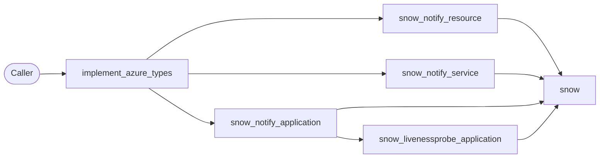
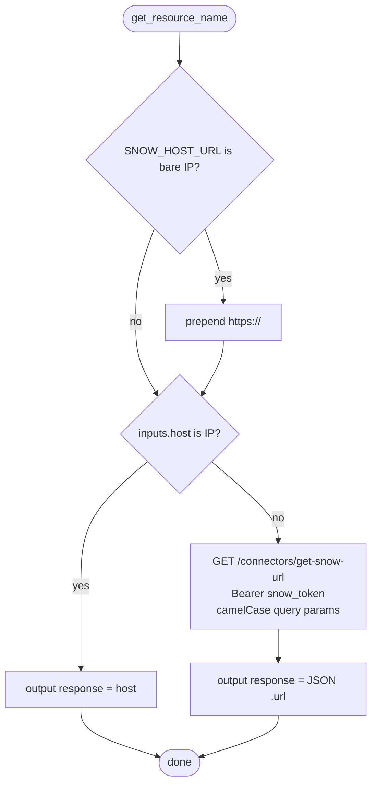
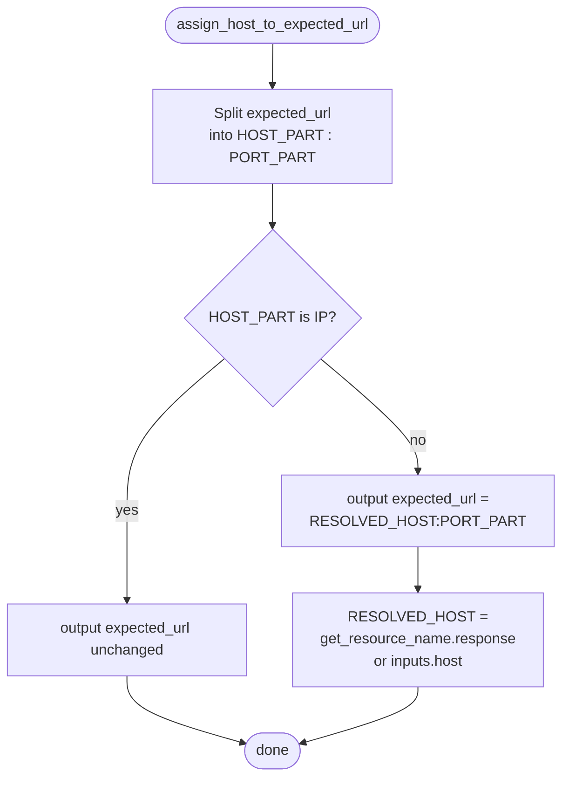
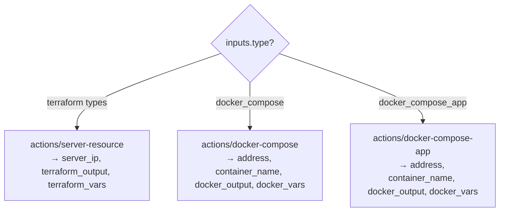

# Workflow logic flow — `main.yml`

Logic flow for `.github/workflows/main.yml`. For caller examples see [EXAMPLES.md](EXAMPLES.md).

---

## Overview

```
Caller repo
    │
    ▼ workflow_call (inputs + secrets)
┌─────────────────────────────────────────────────────────┐
│  main.yml                                               │
│                                                         │
│  Job 1: implement_azure_types                             │
│    checkout → assign_resource → host resolution         │
│    → deployment action                                  │
│                                                         │
│  Job 2: snow_notify_*  (one of four, by type)           │
│                                                         │
│  Job 3: snow_livenessprobe_application  (optional)      │
└─────────────────────────────────────────────────────────┘
    │
    ▼ workflow outputs (server_ip | terraform_output | terraform_vars | address | container_name | docker_output) | docker_vars
Caller repo
```

The workflow always runs **Job 1**. **Job 2** runs based on `inputs.type`. **Job 3** runs only for `docker_compose_app` when `health_url` is not empty.

---

## Job dependency graph



| Job | Runs when | Needs |
|---|---|---|
| `implement_azure_types` | Always | — |
| `snow_notify_resource` | any type that is not `docker_compose` / `docker_compose_app` | `implement_azure_types` |
| `snow_notify_service` | `type == docker_compose` | `implement_azure_types` |
| `snow_notify_application` | `type == docker_compose_app` | `implement_azure_types` |
| `snow_livenessprobe_application` | `docker_compose_app` and `health_url != ''` | `snow_notify_application` |

---

## Job 1: `implement_azure_types`

Single job for all deployment types. **Exactly one** deployment action step runs per workflow call, selected by `inputs.type`.

### Step pipeline

```
checkout
  │
  ├─► assign_resource
  │
  ├─► get_resource_name              [conditional]
  │
  ├─► assign_host_to_expected_url    [conditional]
  │
  └─► deployment action              [one of three paths]
        ├─ server_ip          (type: azurerm_linux_web_app | resource | other non-compose)
        ├─ docker_compose     (type: docker_compose)
        └─ docker_compose_app  (type: docker_compose_app)
```

### Step 1 — `checkout`

Checks out the **caller** repository (the repo that invoked this workflow).

---

### Step 2 — `assign_resource`

If `inputs.resource` is empty, sets `RESOURCE` to `inputs.type` so they have the same value. Output `steps.assign_resource.outputs.resource` is passed to `server-resource`.

---

### Step 3 — `get_resource_name`

**Condition:**

```yaml
(inputs.type == 'docker_compose' || inputs.type == 'docker_compose_app') && inputs.host != ''
```

**Logic:**



| Input | Source |
|---|---|
| `HOST` | `inputs.host` |
| `SNOW_HOST_URL` | `inputs.snow_host_url` |
| `ACTOR_ID` | `github.actor_id` |
| `GIT_TYPE` | `inputs.git_type` |
| `SNOW_TOKEN` | `secrets.snow_token` |

| Case | Behaviour | Output `response` |
|---|---|---|
| Step skipped | `host` empty or type is not docker compose | *(empty)* |
| Host is IP | No API call | The IP |
| Host is name | Snow API lookup | Resolved host/IP from `.url` |

**API:**

```
GET {snow_host_url}/connectors/get-snow-url?snowName={host}&actorId={actor_id}&gitType={git_type}
Authorization: Bearer {snow_token}
```

---

### Step 4 — `assign_host_to_expected_url`

**Condition:**

```yaml
inputs.expected_url != ''
```

**Logic:**



| Input | Source |
|---|---|
| `EXPECTED_URL` | `inputs.expected_url` |
| `HOST` | `inputs.host` |
| `RESOLVED_HOST` | `steps.get_resource_name.outputs.response` |

---

### Step 5 — Deployment action (type dispatch)



| `inputs.type` | Action | Key inputs passed |
|---|---|---|
| `azurerm_linux_web_app` | `actions/server-resource` | Azure credentials, SSH keys, `resource`, `type_values`, `state_values`, `s3_bucket_state`, `git_type` |
| `resource` or other non-compose | `actions/server-resource` | Same Terraform path |
| `docker_compose` | `actions/docker-compose` | `host`, `expected_url`, SSH keys, secrets |
| `docker_compose_app` | `actions/docker-compose-app` | Same as `docker_compose` + Docker cleanup |

**Condition for `server-resource`:**

```yaml
inputs.type != 'docker_compose' && inputs.type != 'docker_compose_app'
```

**Host and URL passed to docker compose actions:**

```yaml
host: ${{ steps.get_resource_name.outputs.response || inputs.host }}
expected_url: ${{ steps.assign_host_to_expected_url.outputs.expected_url || inputs.expected_url }}
```

---

### Job 1 outputs

Forwarded to workflow-level outputs and consumed by notify jobs:

| Job output | Source step | Populated when |
|---|---|---|
| `server_ip` | `steps.server_ip` | `type: azurerm_linux_web_app`, `resource`, or other non-compose |
| `terraform_vars` | `steps.server_ip` | `type: azurerm_linux_web_app`, `resource`, or other non-compose |
| `address` | `steps.docker_compose` **\|\|** `steps.docker_compose_app` | `type: docker_compose` or `docker_compose_app` |
| `container_name` | `steps.docker_compose` **\|\|** `steps.docker_compose_app` | `type: docker_compose` or `docker_compose_app` |
| `docker_output` | `steps.docker_compose` **\|\|** `steps.docker_compose_app` | `type: docker_compose` or `docker_compose_app` |
| `docker_vars` | `steps.docker_compose` **\|\|** `steps.docker_compose_app` | `type: docker_compose` or `docker_compose_app` |

The `||` merge is safe: only one docker compose step runs per call, so the other is always empty.

---

## Jobs 2–3: Snow integration (`snow-iac`)

All notify and health jobs call:

```
snow-monkeys-modules/snow-iac/.github/workflows/main.yml@main
```

**Rules:**
- `actor_id` and `actor_name` come from `github.actor_id` and `github.actor` — not caller inputs.
- `snow_token` is forwarded via job `secrets:`, not `with:`.

### Notify flow by type

```mermaid
flowchart TD
    subgraph server_path [type: azurerm_linux_web_app]
        S1[implement_azure_types] --> S2[snow_notify_resource]
        S2 --> S3[workflow_type: notify\ntype: RESOURCE\nurl: server_ip]
    end

    subgraph resource_path [type: resource or other]
        R1[implement_azure_types] --> R2[snow_notify_resource]
        R2 --> R3[workflow_type: notify\ntype: RESOURCE\nurl: server_ip]
    end

    subgraph service_path [type: docker_compose]
        D1[implement_azure_types] --> D2[snow_notify_service]
        D2 --> D3[workflow_type: notify\ntype: SERVICE\nurl: address or expected_url\nimage: container_name\ndocker_output: docker_output\ndocker_vars: docker_vars]
    end

    subgraph app_path [type: docker_compose_app]
        A1[implement_azure_types] --> A2[snow_notify_application]
        A2 --> A3[workflow_type: notify\ntype: APPLICATION\nurl: address or expected_url\nimage: container_name\ndocker_output: docker_output\ndocker_vars: docker_vars]
        A3 --> A4{health_url empty?}
        A4 -->|no| A5[snow_livenessprobe_application]
        A5 --> A6[workflow_type: health]
        A4 -->|yes| skip[skip liveness]
    end
```



### URL fallback (service and application notify)

When deployment address is empty, Snow receives `inputs.expected_url`:

```yaml
url: ${{ needs.implement_azure_types.outputs.address != '' && needs.implement_azure_types.outputs.address || inputs.expected_url }}
```

---

## End-to-end paths

### Path A — `type: azurerm_linux_web_app`, `resource`, or other non-compose

```
checkout
  → assign_resource
  → server-resource action (Terraform in iac-terraform/v1/modules/dev/azure/$RESOURCE)
       assign TF_STATE_BUCKET / TF_STATE_KEY_PREFIX
       write env_values + type_values + state_values (.env and TF_VAR_*)
       terraform init (drop backend.tf, or bucket/key/region and encrypt=true)
       plan / apply (or destroy)
  → snow_notify_resource (RESOURCE)
  → outputs: server_ip, terraform_output, terraform_vars
```

`TF_STATE_KEY_PREFIX` is `{name}/{git_type}/{actor_id}/{sha}`. `region` comes from `state_values`. `encrypt` is always `true`. Empty `s3_bucket_state` skips `plan`.

### Path B — `type: docker_compose`

```
checkout
  → get_resource_name (if host set)
  → assign_host_to_expected_url (if expected_url set)
  → docker-compose action (SSH deploy, init.sh)
  → snow_notify_service (SERVICE, url + container_name + docker_output + docker_vars)
  → outputs: address, container_name, docker_output, docker_vars
```

### Path C — `type: docker_compose_app`

```
checkout
  → get_resource_name (if host set)
  → assign_host_to_expected_url (if expected_url set)
  → docker-compose-app action (cleanup + SSH deploy)
  → snow_notify_application (APPLICATION, url + container_name + docker_output + docker_vars)
  → snow_livenessprobe_application (if health_url set)
  → outputs: address, container_name, docker_output, docker_vars
```

---

## Workflow outputs (caller-facing)

| Output | Set on path | Value |
|---|---|---|
| `server_ip` | A | Provisioned server public IP |
| `terraform_vars` | A | Non-secret `TF_VAR_*` values as JSON |
| `address` | B, C | SSH host used for deployment |
| `container_name` | B, C | stdout from remote `init.sh` |
| `docker_output` | B, C | `docker logs` for that container, as JSON `{"container_name":"...","logs":"..."}` |
| `docker_vars` | B, C | Compose service fields (`image`, `container_name`, `ports`, and the rest) as JSON |

Unset outputs are empty strings for paths that do not produce them.

---

## Quick reference: what drives each decision

| Decision | Driver |
|---|---|
| Fill empty `resource` | `assign_resource` copies `type` |
| Run host resolution | `type` is compose + `host` not empty |
| Run expected_url normalization | `expected_url` not empty |
| Which deployment action | `inputs.type` |
| Which notify job | `inputs.type` |
| Run liveness probe | `type == docker_compose_app` + `health_url != ''` |
| Terraform remote backend | `s3_bucket_state` set; `region` from `state_values`; key from `name` / `git_type` / actor / sha; `encrypt=true` |
| Snow resource kind | `CLUSTER` / `RESOURCE` / `SERVICE` / `APPLICATION` |

---

## Related docs

- [INPUTS_OUTPUTS.md](INPUTS_OUTPUTS.md) — inputs, secrets, and outputs reference
- [NAMING.md](NAMING.md) — snake_case / camelCase conventions
- [README.md](../README.md) — Azure module quick start
- [CLAUDE.md](../CLAUDE.md) — maintainer editing rules
