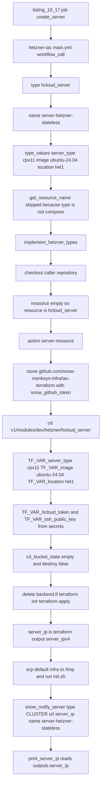
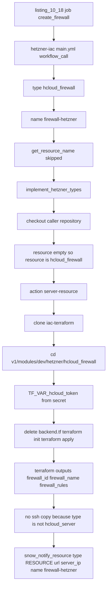
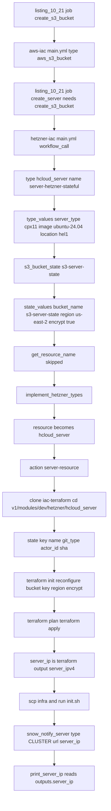
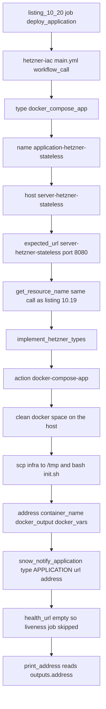

# Reusable workflow usage

Each listing is one caller workflow. The path under it is the order `hetzner-iac/.github/workflows/main.yml` runs for that listing.

Type names are the Hetzner rows in `snow-monkeys-modules/master-modules/list-of-resources.md`.

| `type` | Action | Snow notify |
| --- | --- | --- |
| `hcloud_server` | `server-resource` | `CLUSTER` |
| `hcloud_firewall`, `hcloud_network`, `hcloud_volume`, `hcloud_volume_attachment`, `hcloud_floating_ip` | `server-resource` | `RESOURCE` |
| `docker_compose` | `docker-compose` | `SERVICE` |
| `docker_compose_app` | `docker-compose-app` | `APPLICATION` |

## Listing 10.17 — `hcloud_server`

File: `yabinboxes/master-yabinboxes/body/part-04-core-modules/chapter-10-hands-on-reusable-workflows/03-hands-on-example/hetzner/listing_10_17_server_stateless.yml`

```yaml
create_server:
  uses: snow-monkeys-modules/hetzner-iac/.github/workflows/main.yml@main
  with:
    type: hcloud_server
    name: server-hetzner-stateless
    type_values: |
      server_type=cpx11
      image=ubuntu-24.04
      location=hel1
  secrets:
    hcloud_token: ${{ secrets.HETZNER_CLOUD_TOKEN }}
    ssh_public_key: ${{ secrets.SSH_PUBLIC_KEY }}
    ssh_private_key: ${{ secrets.SSH_PRIVATE_KEY }}
    snow_token: ${{ secrets.SNOW_TOKEN }}
    snow_token_pipeline: ${{ secrets.SNOW_TOKEN_PIPELINE }}
```



`list-of-resources.md` maps `hcloud_server` to CLUSTER. That is why the notify job is `snow_notify_server` and the Snow type is `CLUSTER`.

`hcloud_server/variables.tf` also has `name` default `CX23`, `ipv4_enabled` default `true`, `ipv6_enabled` default `false`. This listing does not set them.

This listing does not pass `snow_github_token`. The clone step still reads that secret.

`r` is `continue-on-error: true`. It runs only because `type` is `hcloud_server` and apply succeeded.

## Listing 10.18 — `hcloud_firewall`

File: `.../hetzner/listing_10_18_firewall_stateless.yml`

```yaml
create_firewall:
  uses: snow-monkeys-modules/hetzner-iac/.github/workflows/main.yml@main
  with:
    type: hcloud_firewall
    name: firewall-hetzner
  secrets:
    hcloud_token: ${{ secrets.HETZNER_CLOUD_TOKEN }}
    snow_token: ${{ secrets.SNOW_TOKEN }}
    snow_token_pipeline: ${{ secrets.SNOW_TOKEN_PIPELINE }}
```



`list-of-resources.md` maps `hcloud_firewall` to RESOURCE. No `type_values`, so `name`, `labels`, `rules`, and `apply_to` stay at the module defaults. This file has no job that reads an output.

The same `server-resource` path is used for the other RESOURCE folders:

| `type` | Terraform directory | Variables besides `hcloud_token` | Outputs |
| --- | --- | --- | --- |
| `hcloud_network` | `v1/modules/dev/hetzner/hcloud_network` | `name`, `ip_range`, `labels`, `delete_protection`, `expose_routes_to_vswitch` | `network_id`, `network_name`, `ip_range` |
| `hcloud_volume` | `v1/modules/dev/hetzner/hcloud_volume` | `name`, `size`, `location`, `server_id`, `automount`, `format`, `labels`, `delete_protection` | `volume_id`, `volume_name`, `linux_device`, `location` |
| `hcloud_volume_attachment` | `v1/modules/dev/hetzner/hcloud_volume_attachment` | `volume_id`, `server_id`, `automount` | `volume_attachment_id`, `volume_id`, `server_id` |
| `hcloud_floating_ip` | `v1/modules/dev/hetzner/hcloud_floating_ip` | `type`, `name`, `home_location`, `server_id`, `description`, `labels`, `delete_protection` | `floating_ip_id`, `ip_address`, `floating_ip_name`, `home_location` |

## Listing 10.21 — `hcloud_server` with S3 state

File: `.../hetzner/listing_10_21_server_stateful.yml`

The first job is not `hetzner-iac`. It calls `snow-monkeys-modules/aws-iac/.github/workflows/main.yml@main` with `type: aws_s3_bucket`, `name: s3-server-state`, and `type_values` `bucket_name=s3-server-state`, `region=us-east-2`, `versioning=true`, `encrypt=true`.



Secrets on `create_server`: `hcloud_token`, `ssh_public_key`, `ssh_private_key`, `snow_token`, `snow_token_pipeline`, `aws_access_key_id`, `aws_secret_access_key`. The S3 init uses the AWS secrets. `region` and `encrypt` come from `state_values`. If either is missing, init fails.

## Listing 10.19 — `docker_compose`

File: `.../hetzner/listing_10_19_service_stateless.yml`

`host` is `server-hetzner-stateless`, the `name` from Listing 10.17. This file does not `needs` that listing.

```yaml
deploy_service:
  uses: snow-monkeys-modules/hetzner-iac/.github/workflows/main.yml@main
  with:
    type: docker_compose
    name: service-hetzner-stateless
    host: server-hetzner-stateless
    expected_url: server-hetzner-stateless:8080
    infra: infra
  secrets:
    snow_token: ${{ secrets.SNOW_TOKEN }}
    snow_token_pipeline: ${{ secrets.SNOW_TOKEN_PIPELINE }}
```



```mermaid
flowchart TD
  a["listing_10_19 job deploy_service"]
  b["hetzner-iac main.yml workflow_call"]
  c["type docker_compose"]
  d["name service-hetzner-stateless"]
  e["host server-hetzner-stateless"]
  f["expected_url server-hetzner-stateless port 8080"]
  g["infra infra"]
  h["get_resource_name calls snow-iac workflow_type get_resources"]
  i["resource_name is host actor_id is github.actor_id git_type github"]
  j["secrets snow_token and snow_token_pipeline"]
  k["response is the resolved host"]
  l["implement_hetzner_types"]
  m["resource becomes docker_compose"]
  n["expected_url host replaced with response port stays 8080"]
  o["action docker-compose"]
  p["host is response"]
  q["checkout strip http write ssh_private_key"]
  r["scp infra to /tmp write env_values to /tmp/.env"]
  s["bash init.sh stdout is container_name"]
  t["address is the ssh host"]
  u["snow_notify_service type SERVICE url address image container_name"]
  v["print_address reads outputs.address"]
  a --> b --> c --> d --> e --> f --> g --> h --> i --> j --> k --> l --> m --> n --> o --> p --> q --> r --> s --> t --> u --> v
```

This listing does not pass `ssh_private_key` or `env_values`. The action still has those steps. No `iac-terraform` clone. No Docker cleanup. That cleanup is only on `docker_compose_app`.

## Listing 10.20 — `docker_compose_app`

File: `.../hetzner/listing_10_20_application_stateless.yml`

```yaml
deploy_application:
  uses: snow-monkeys-modules/hetzner-iac/.github/workflows/main.yml@main
  with:
    type: docker_compose_app
    name: application-hetzner-stateless
    host: server-hetzner-stateless
    expected_url: server-hetzner-stateless:8080
    infra: infra
  secrets:
    snow_token: ${{ secrets.SNOW_TOKEN }}
    snow_token_pipeline: ${{ secrets.SNOW_TOKEN_PIPELINE }}
```



`Clean Docker space` writes `/etc/docker/daemon.json` log options `max-size` `10m` and `max-file` `3`, reloads Docker, truncates container json logs, then `docker system prune -f`.

`snow_livenessprobe_application` runs only when `health_url` is not empty. This listing does not set `health_url`.
